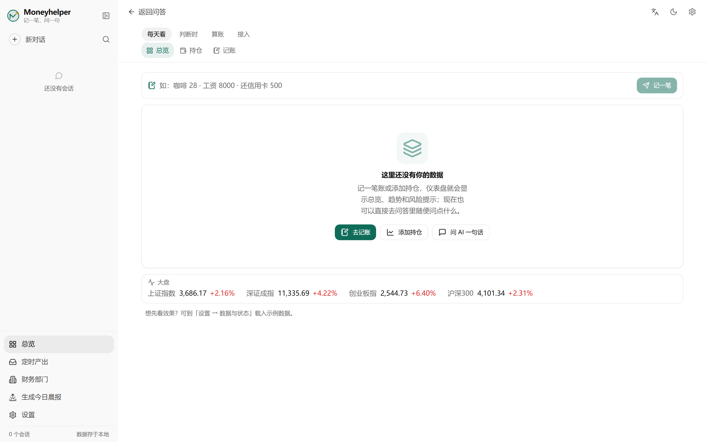
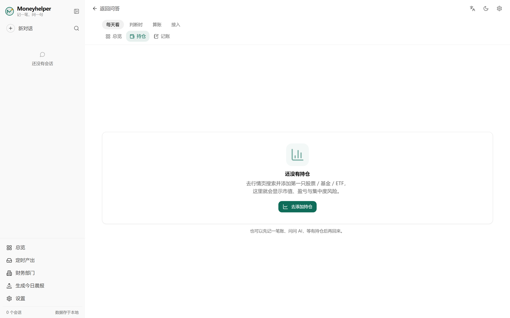
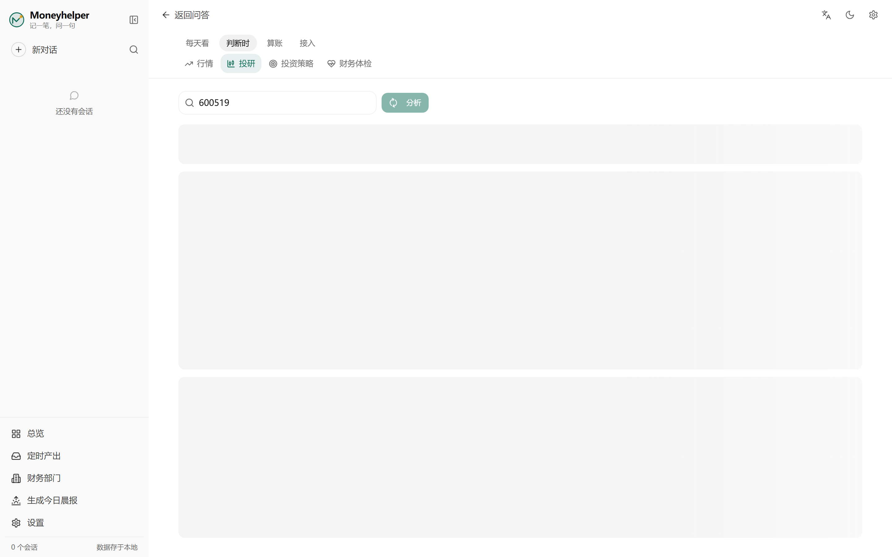
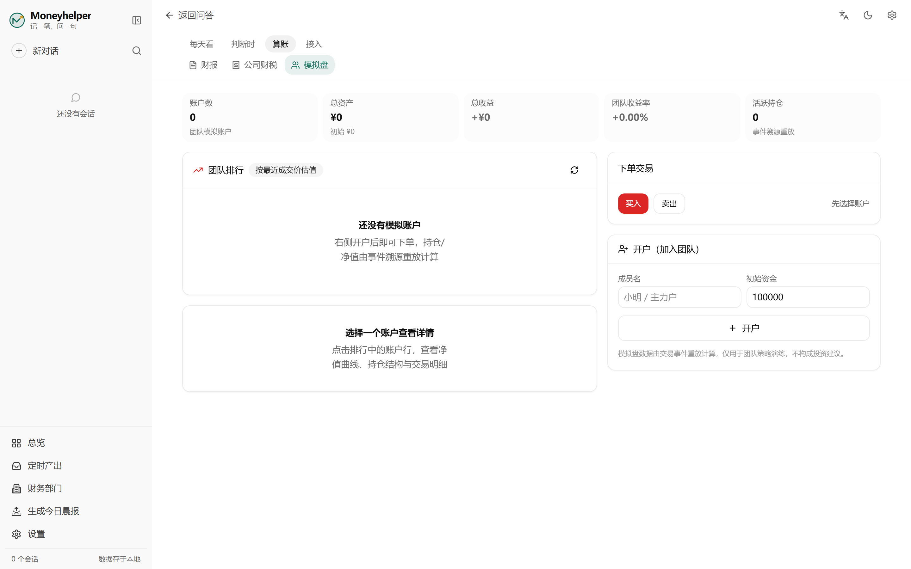
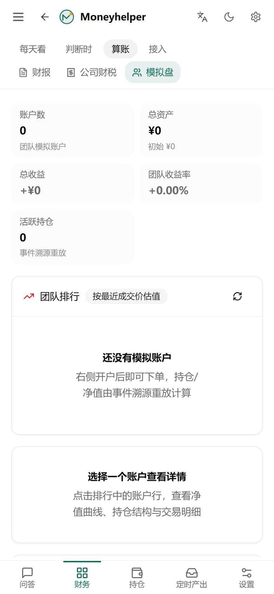

# Moneyhelper

**一句话记账，一个数字看清全部家底。** 自己跑在本地，不连云端。

[](https://github.com/badhope/moneyhelper/releases)
[](#验证)
[](LICENSE)

[English](README.en.md) · [CLI 文档](docs/CONFIG.md) · [部署](docs/DEPLOY.md)

---

## 安装

```bash
# 方式一：桌面版（双击即用）
下载 release 里的 Moneyhelper.exe

# 方式二：Docker
docker compose up -d          # → http://localhost:8787

# 方式三：命令行
pip install -e .
moneyhelper add "午餐 45 打车 28"
```

---

## 界面

| 总览 | 持仓 |
|---|---|
|  |  |

| 投研 | 模拟盘 |
|---|---|
|  |  |

移动端：

<p align="center">
  
  
  
</p>

---

## 能做什么

**账本**
一句话记多笔（`午餐 45 打车 28` → 两条流水）；CSV 账单导入；加密备份。

**持仓与风控**
持仓明细、集中度与行业分布、盈亏归因、再平衡建议。

**策略回测**
5 个策略，参数与失效场景都写在结果里：

| 策略 | 适合 | 失效场景 |
|---|---|---|
| 双均线 | 中期趋势 | 震荡市反复止损 |
| 定投 | 长期积累 | 单边下跌仍亏损 |
| 网格 | 区间震荡 | 单边下跌买满套牢 |
| 趋势跟随 | 大级别趋势 | 假突破频繁 |
| 波动率目标 | 控制回撤 | 波动率跳升滞后 |

**净值追踪**
每日快照，把「涨了」拆成 **存的 / 涨的 / 还债的** 三部分。

**报告**
单文件 HTML，离线可看、可打印 PDF。

**AI 对话**
一句话问「这个月花哪了」，走本地计算引擎，模型只负责写话。

---

## 为什么数字可信

计算层是纯函数，没有网络、没有数据库、没有随机。

```
用户提问 → 意图路由 → 工具调用 → calculations/*.py（纯函数）
                                        ↓
                                   数字回填 → 模型只写叙述
```

模型**没有写数字的通道**。它拿到的永远是算好的结果，只能组织语言。

---

## 验证

```bash
# 后端
cd backend && pytest -q          # 1370+ passed
# 前端
cd frontend && npm test          # 129 passed
# 截图
node frontend/e2e/shots-full.mjs  # 20 张，零溢出
```

---

## 边界

- 不代客下单，实盘只生成交接单
- 不给税务筹划建议，只按公式算
- 不预测收益，回测标注假设与失效条件

MIT License · [安全策略](SECURITY.md) · [贡献指南](CONTRIBUTING.md)
