# Moneyhelper

Self-hosted finance software that keeps the books for you. Write one sentence — it books the entry, reconciles the bank, closes the month, and answers with figures that come from code rather than from a language model.

[English](README.md) · [简体中文](README.zh.md) · [Docs](docs/index.md) · [CLI](docs/cli.md) · [Deploy](docs/DEPLOY.en.md)

[](https://github.com/badhope/moneyhelper/actions/workflows/ci.yml)
[](LICENSE)

<p align="center">
  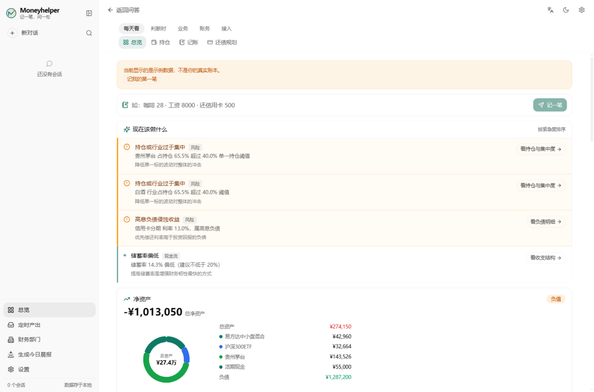
</p>
<p align="center">
  
  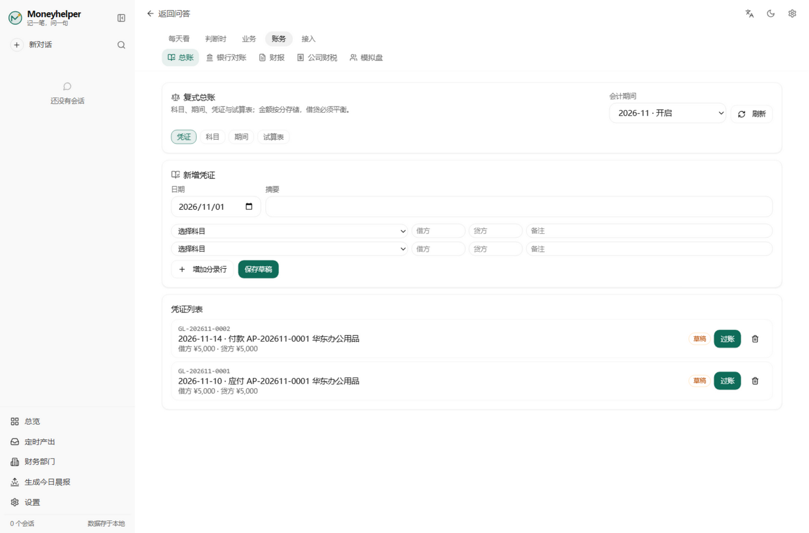
</p>

---

## The one idea

Almost every "AI finance" product asks the model to produce the numbers. That is the part where finance cannot afford to be creative.

Here the split is the other way round: a deterministic calculation engine fills in every figure, and the model is only allowed to phrase the answer. It has no channel for inventing a number — no arithmetic in prompts, no estimates dressed up as results. When a sample is too small, the API returns `null` with a reason instead of a figure that merely looks plausible.

```
question → intent routing → tool call → calculations (pure functions)
                                              ↓
                              numbers filled in → model writes prose
```

Every figure carries a provenance record: which tool, which arguments, which code path produced it.

---

## What it does

**Personal.** One sentence becomes several entries — `lunch 45, taxi 28` is two transactions, not one. WeChat Pay, Alipay, bank CSV, PDF statements, invoice QR codes and OCR import natively. Positions, concentration risk, rebalancing, backtests and monthly reports sit in the same ledger.

**Enterprise.** Multiple tenants, departments and memberships. A real double-entry general ledger: chart of accounts, periods, journals, draft → post → reverse, trial balance, period lock. Expense claims with applicant ≠ approver. Procurement that walks vendor → purchase order → payable → payment, each step creating the correct voucher. Bank reconciliation by account, amount and direction, with statement-versus-book balance and a sign-off gate.

Both sides share one engine, so a family ledger and a company ledger obey the same accounting rules — one installation can hold your household and your business without mixing them.

**Automation that runs unattended, with a ledger of its own.** Month-end close posts the drafts and locks the period on a schedule. Recurring imports, anomaly scans and the morning digest do not wait for a click. Each scheduled or manual run records its workflow, steps, duration, return values and errors; reruns are idempotent and serialised per workflow. Long-running work — a report, a paper, a small web app — runs as a staged task with resumable artifacts.

<p align="center">
  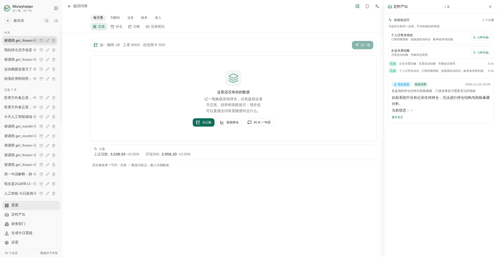
</p>

**Failure is recorded, not swallowed.** Month-end and its snapshot retry with exponential backoff because they are idempotent; sync and inbox imports do not auto-retry, so a restart cannot duplicate transactions. A failed or partial run creates a dead-letter alert, and replay creates a new run instead of overwriting the old evidence. On startup, only a month-end that was missed and is still safe to replay is caught up.

<p align="center">
  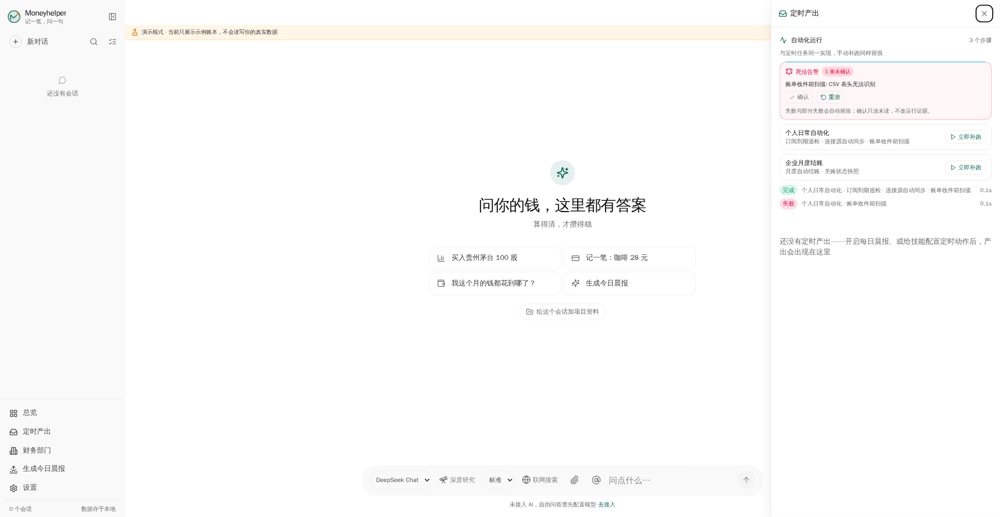
  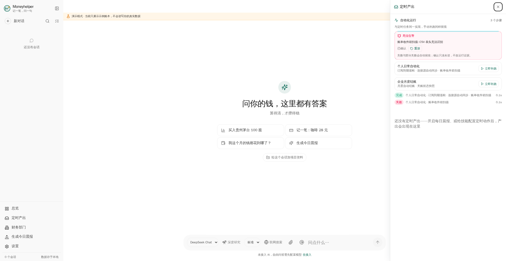
</p>

**A tax and cash timeline you can audit, and attribution you approve.** The tax workspace now reads only posted entries and aggregates revenue, expense, profit, cash in/out and tax accrual by month; missing months stay explicitly missing instead of showing a fake zero. Attribution proposes a category from the rule table or the ledger history, shows the rule id, matched term and confidence, and writes nothing until you confirm. You can add keyword/direction/priority rules, confirm up to 100 rows in one atomic batch, and roll back a wrong call row by row; before/after and rule evidence stay recorded.

<p align="center">
  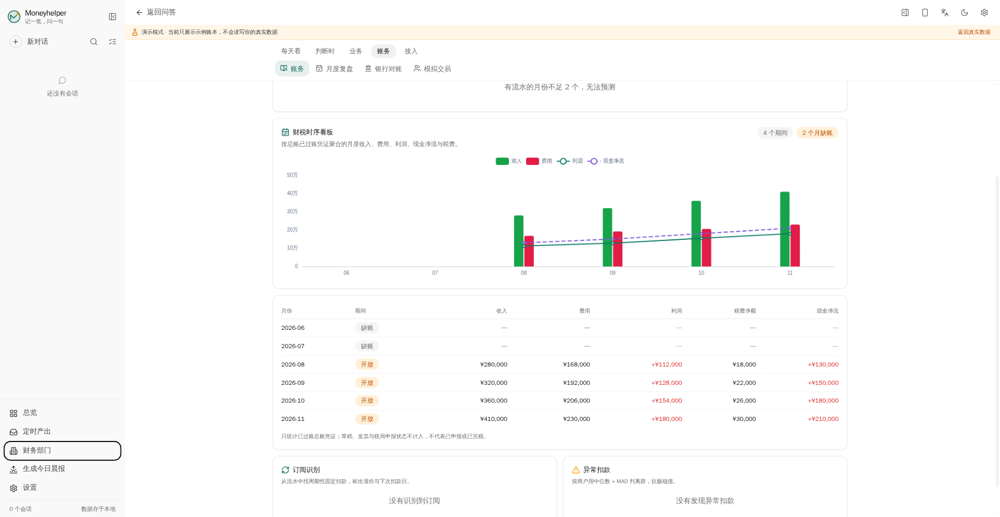
  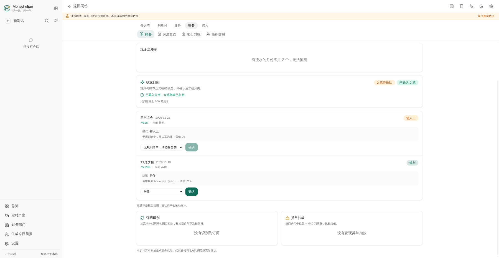
</p>
<p align="center">
  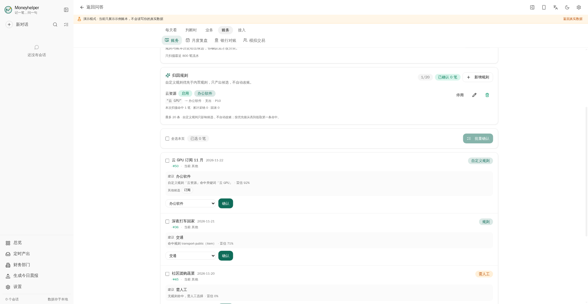
  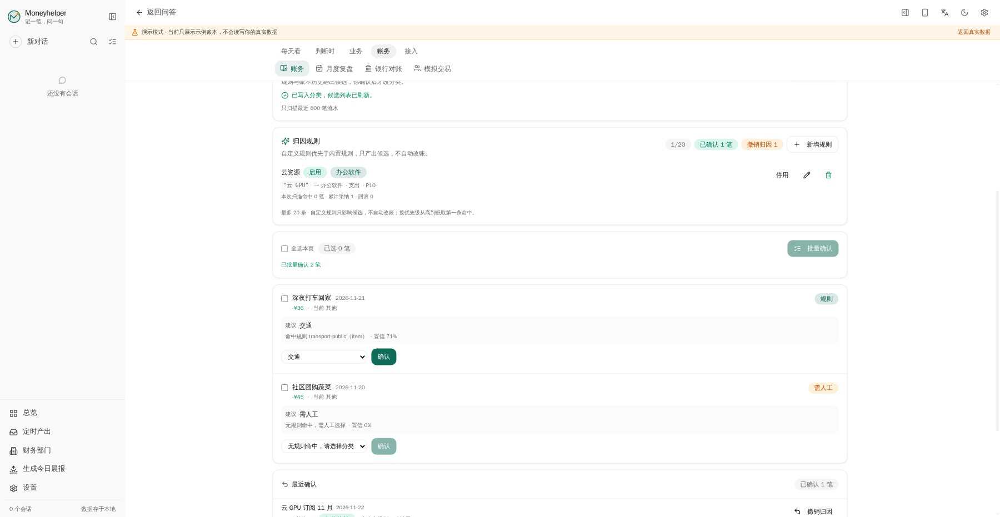
</p>

**Multi-entity consolidation on a management basis.** Parent and subsidiaries can be combined inside the existing statements page, without adding a new top-level section. `full` is allowed only at 100%; `proportional` scales each trial-balance line by ownership. Consolidation reads posted vouchers only; an entity with no period or no posted entries is marked missing and excluded instead of being counted as zero. Eliminations are entered manually, checked for debit-credit balance, and never written back to any entity ledger.

<p align="center">
  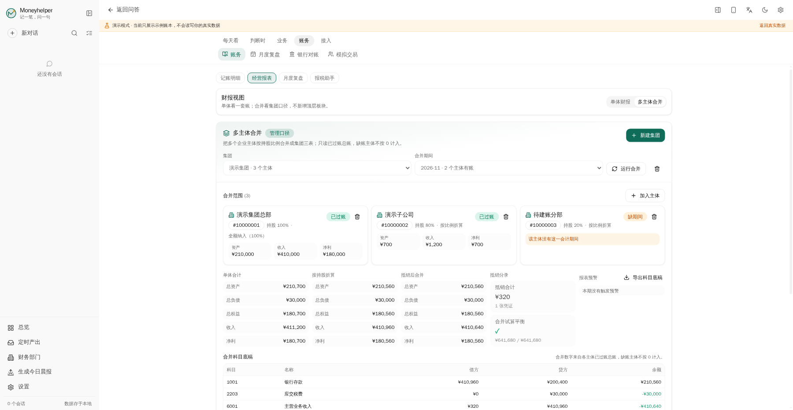
</p>

**Enterprise budgets and cash plans that reach execution.** The ledger workspace gains a Budget & Cash tab: budgets by `YYYY-MM`, actuals only from posted GL entries, unbudgeted accounts flagged, drafts counted separately. Cash plans arrange dated inflows and outflows, allow only cash accounts 1001/1002, take the opening balance from you, and output projected ending balance, actual-to-date, daily variance and buffer warnings. Both write planning tables only: no vouchers, no transfers.

<p align="center">
  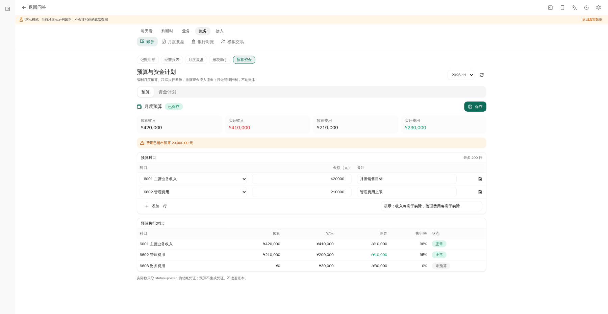
  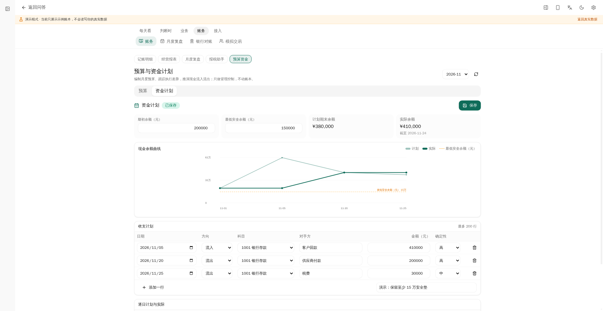
</p>

On the personal side, the dashboard adds an asset tune-up card that turns emergency-buffer gaps, high-interest debt, concentration, target drift and savings rate into candidates with impact and risk. Every candidate needs confirmation; no orders, no repayments. Tax-timeline rows now expand to the month's posted vouchers and account lines, and attribution rules gain merchant, amount range and member dimensions.

<p align="center">
  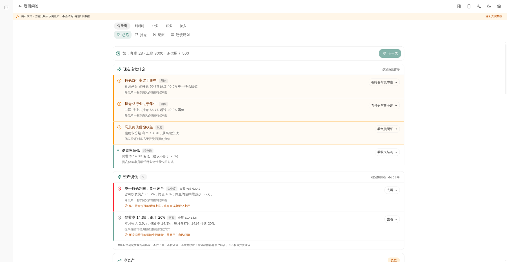
</p>

**The last mile of filing, paying and auditing becomes a handoff packet.** The ledger workspace gains an External Handoff tab. The tax worksheet reads only the month's posted vouchers and reports income, expense, tax, debit-credit totals and eight reconciliation checks, always marked "not submitted · review only". The payment draft turns each cash-plan outflow into an instruction with payee, amount and certainty, always marked "draft · cannot execute". The consolidation audit packet bundles the management-basis worksheet, entity status, eliminations and a source hash, always marked "not audited · management basis". All three are downloadable and reviewable, but none submits to a tax bureau, moves money or issues a statutory opinion.

<p align="center">
  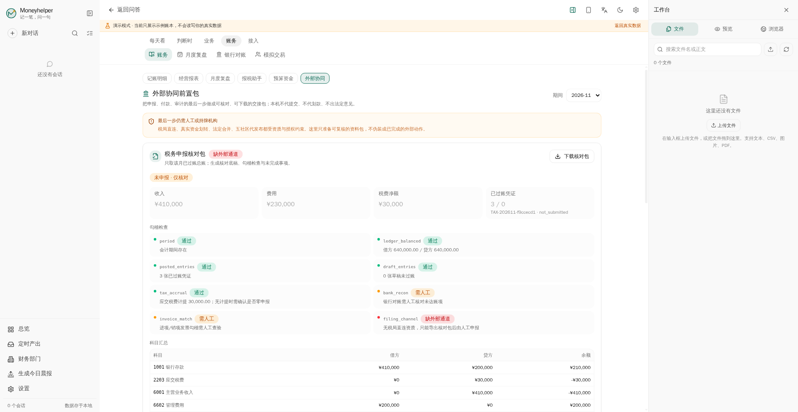
  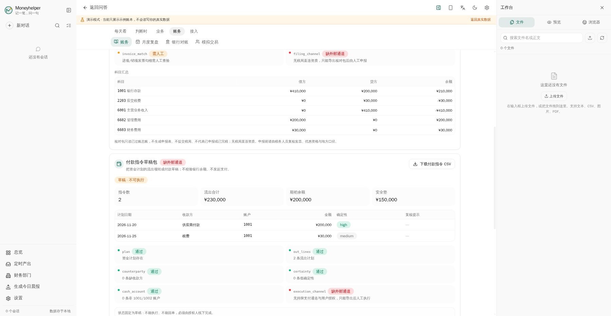
</p>

**A handed-off pack still needs a paper trail.** Each pack card now has an Archive action that appends its packet ID, period, source digest and note to the local audit hash chain, with no new business table. The handoff ledger at the bottom separates "archive only" from "handed over offline" and compares the stored digest with the pack regenerated on screen, showing "matches current pack" or a red mismatch. Offline confirmation only records that you say it was given to a person; it is not a tax receipt, payment confirmation or audit opinion.

<p align="center">
  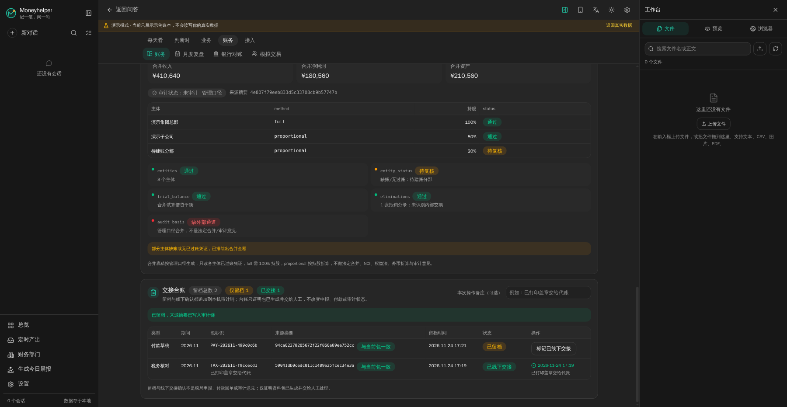
  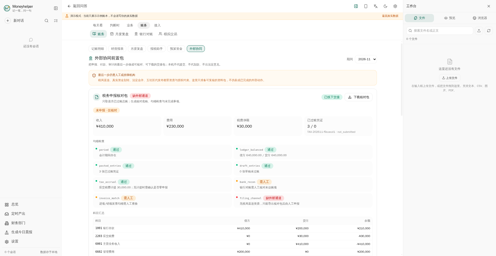
</p>

**Everything is addressable by your own agent.** The same capabilities are exposed through MCP, so Claude, Codex or any MCP client can drive the books with your permission.

---

## Quick start

```bash
# Docker
docker compose up -d            # → http://localhost:8787

# From source (Python 3.10+, Node 20.19+)
scripts/dev.sh --prod           # venv + deps + frontend build, serves on :8788

# CLI
pip install -e .
moneyhelper add "lunch 45, taxi 28"
```

Prebuilt installers and single-file binaries are attached to [Releases](https://github.com/badhope/moneyhelper/releases). Data lives in a local SQLite file: no account, no telemetry, no cloud round-trip.

---

## Remote control from your phone

Open **Remote control** from the phone icon in the top bar and generate a one-time link plus QR code. Scanning it opens the same app, not a cut-down chat page: conversations, files, previews, the browser rail, finance pages and settings all work. The phone is only a control surface; data and execution stay on the desktop.

- The token lives after `#`, so the browser never sends it to the server or into access logs. It expires in 10 minutes and is burned on first use.
- Pairing exchanges it for an `HttpOnly` device cookie, valid for 12 hours by default (1–168 configurable). Closing the panel does not disconnect; **Stop** revokes immediately. **Refresh QR** invalidates the old link and kicks the connected device.
- Set **Public URL** to an address the phone can reach: `http://192.168.x.x:8788` on a LAN, or `https://money.example.com` on the internet. A loopback address is flagged as unreachable from the phone.
- **No public IP needed**: run `python -m app.relay.server` on a public host, enter the `ws://` control URL and token in the remote panel, and the desktop dials out. The relay allocates a public port for the phone. Your ledger passes only through your own relay, never a third-party one.

## What it deliberately does not do

- **No live trading.** Pre-trade checks produce a confirmation token; live orders generate a handoff sheet. The default broker is a dry-run stub.
- **No tax advice.** It applies published formulas and labels the output an estimate.
- **No forecasts sold as facts.** Backtests state their assumptions and the conditions under which they break.
- **No silent failure.** Optional capabilities (OCR, PDF parsing, broker SDKs) degrade with an install hint rather than pretending to work.

---

## Why it is safe to run unattended

It is local-first, and built so the program cannot quietly rewrite itself:

- Changing permission modes, agent roles, system prompts, model endpoints, MCP servers or backup restore requires the instance administrator.
- A path guard refuses to point the data directory at source code, `.git` or dependency manifests.
- `stdio` MCP servers are disabled unless explicitly enabled; working directories inside the source tree are rejected.
- Backup restore brings back preferences only — never permission modes, prompts, endpoints or API keys.
- The hooks that audit write operations cannot be disabled or deleted.

---

## Verify it yourself

```bash
bash scripts/verify-all.sh                          # static guards + backend + frontend + build
bash scripts/verify-all.sh --with-e2e                # + Playwright: every page, every settings section
bash scripts/verify-all.sh --with-e2e --with-live    # + real-model acceptance (needs LLM_API_KEY)
```

A green unit test proves a function works, not that a user can reach it. So there are three separate gates: every HTTP endpoint is probed for server errors and checked for readable failure text, the MCP surface is exercised through a real protocol client, and seeded hostile data (very long names, infinity, epoch dates) is rendered to catch layout breaks.

---

## Architecture

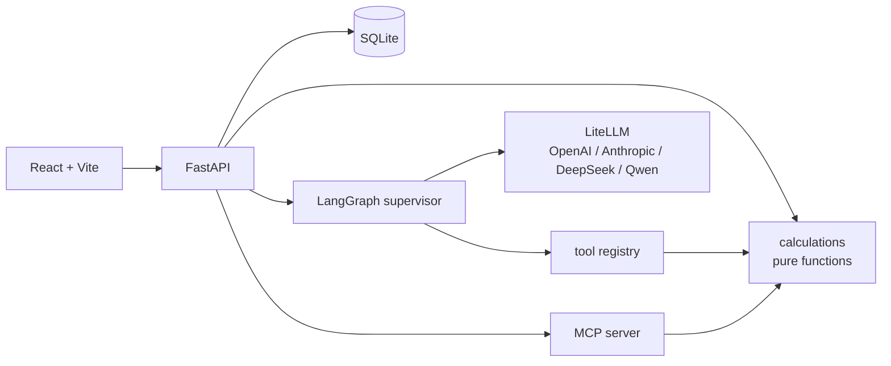

```
backend/app/
  calculations/    deterministic engine — no I/O, testable in isolation
  routes/          HTTP layer: parameter cleaning and assembly only
  db/              domain-split SQLite access, migrations, undo snapshots
  import_parsers/  WeChat / Alipay / generic CSV / PDF / invoice decoders
  agents/          supervisor + bookkeeping + portfolio + research
moneyhelper/       stable facade packages (core / server / cli / mcp)
frontend/src/      React UI, lazy-loaded per section
```

Detail: [architecture.md](docs/architecture.md) · [module-map.md](docs/module-map.md) · [MCP guide](docs/mcp-guide.md)

---

## Documentation

| Start here | |
|---|---|
| [docs/index.md](docs/index.md) | Documentation map |
| [DEVELOPMENT.en.md](docs/DEVELOPMENT.en.md) | Local setup and conventions |
| [DEPLOY.en.md](docs/DEPLOY.en.md) | Deployment and configuration |
| [cli.md](docs/cli.md) | Command line |
| [mcp-guide.md](docs/mcp-guide.md) | Driving the books from an MCP client |
| [ARCHITECTURE-detail.md](docs/ARCHITECTURE-detail.md) | Why the layers are split this way |

MIT License · [Security](SECURITY.md) · [Contributing](CONTRIBUTING.md) · [Code of Conduct](CODE_OF_CONDUCT.md) · [Changelog](CHANGELOG.md)
