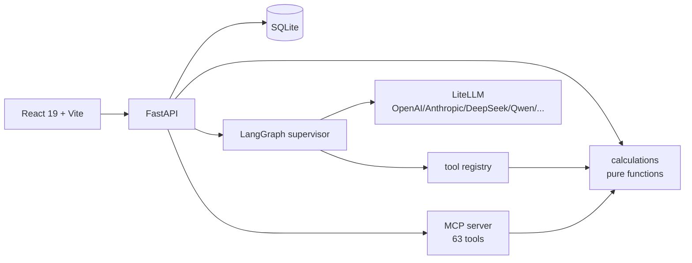

# Moneyhelper

**An AI finance department you can audit.** Bookkeeping, portfolio risk, research, statements, tax and cash scheduling — every number computed by deterministic code, never by the model.

[English](README.md) · [简体中文](README.zh.md) · [Docs](docs/index.md) · [CLI](docs/cli.md) · [Deploy](docs/DEPLOY.en.md)

[](https://github.com/badhope/moneyhelper/actions/workflows/ci.yml)
[](https://github.com/badhope/moneyhelper/releases)
[](#verification)
[](LICENSE)
[](pyproject.toml)
[](docs/mcp-guide.md)

<p align="center">
  
</p>

---

## Install

```bash
# 1) Desktop — download and run, no Python needed
#    release assets: moneyhelper-windows-x64.exe / moneyhelper-macos-arm64 / moneyhelper-linux-x64

# 2) Docker
docker compose up -d                 # → http://localhost:8787

# 3) From source
scripts/dev.sh --prod                # venv + pip + frontend build + serve on :8788
pip install -e . && moneyhelper add "lunch 45, taxi 28"
```

Requires Python 3.10+ and Node 20.19+ for the source install. Data lives in a local SQLite file — no account, no telemetry, no cloud round-trip.

---

## What it does

| | |
|---|---|
| **Ledger** | One sentence, many entries: `午餐 45 打车 28` becomes two transactions. WeChat Pay, Alipay, bank CSV, PDF statements, invoice QR codes and OCR all import natively. |
| **Portfolio** | Positions, concentration and sector breakdown, P&L attribution, rebalance orders sized to whole lots. |
| **Debt payoff** | Avalanche vs snowball, month-by-month amortization, debt-free date, and how much interest the extra payment actually saves. |
| **Research** | Technical indicators, 5 backtest strategies, statistical price scenarios (trend regression, volatility bands, Monte Carlo with a fixed seed). |
| **Statements** | Three-statement analysis: 20+ ratios, DuPont decomposition, year-over-year deltas, anomaly flags. |
| **Tax (CN)** | VAT and surcharges, corporate income tax, cumulative withholding for individuals, payroll with social insurance and housing fund. |
| **Cash flow** | Three-scenario forecast, subscription detection, anomaly detection via median + MAD. |
| **Reports** | Single-file interactive HTML, offline-readable, printable to PDF. |
| **MCP** | 63 tools over the Model Context Protocol — any MCP client can drive the ledger. |

<p align="center">
  
  
</p>

---

## Why the numbers hold up

The calculation layer is pure functions: no network, no database, no randomness (Monte Carlo is seeded).

```
question → intent routing → tool call → calculations/*.py (pure functions)
                                              ↓
                                     numbers filled in → model only writes prose
```

**The model has no channel for inventing numbers.** It receives computed values and can only phrase them. Every figure carries a provenance record, and every metric documents its formula and its failure modes in the docstring — when the sample is too small the API returns `null` with a reason rather than a plausible-looking number.

Two examples of that discipline being enforced rather than claimed:

- Backtests used to report `+44887% annualized` on a 62% drawdown. The curve ignored cash and compared endpoints. Fixed to hold cash in the curve, use XIRR for annualized return, and derive drawdown and Sharpe from the TWR series.
- Health score returned 54/D over MCP and 83/B over REST for the same data. Both paths now call the same function.

---

## Design principles

**Local by default, deployable anywhere.** SQLite on your machine; the same core runs as a desktop binary, a self-hosted server, or a container. Only de-identified structured context is sent to the model provider — the ledger itself never leaves.

**Chinese bill formats are first-class.** WeChat and Alipay exports are parsed structurally, not through a generic fallback guessing at column names. Invoice QR decoding and OCR are real decoders, and both degrade with an explicit "install this" message when the optional dependency is missing.

**Trading is never automated blindly.** Pre-trade checks (price limits, lot size, T+1, concentration, daily caps, duplicate orders) produce a confirmation token; live orders generate a handoff sheet. The default broker is `NullBroker` in dry-run.

**Failures degrade, they don't 500.** Market data unreachable → the affected card returns `available: false` with a reason while the rest of the page keeps working. A backtest is pure computation, so it stays available even when quotes are down — which is exactly when you want to review it offline.

---

## Architecture



```
backend/app/
  calculations/    deterministic engine — no I/O, unit-testable in isolation
  routes/          HTTP layer: parameter cleaning and assembly only
  db/              domain-split SQLite access, migrations, undo snapshots
  import_parsers/  WeChat / Alipay / generic CSV / PDF / invoice decoders
  agents/          supervisor + bookkeeping + portfolio + research
moneyhelper/       stable facade packages (core / server / cli / mcp)
frontend/src/      React UI, lazy-loaded per section
```

Full detail: [architecture.md](docs/architecture.md) · [module-map.md](docs/module-map.md)

---

## Verification

```bash
cd backend  && pytest -q                              # 1,500+ passed
cd frontend && npx vitest run && npx tsc --noEmit     # 180+ passed, zero type errors
node frontend/e2e/shots-full.mjs http://127.0.0.1:8788  # 22 screenshots, zero overflow
python backend/scripts/seed_hostile.py .tmp/h.db      # hostile-data render check
```

Gates that run in CI: ruff, pytest, `tsc --noEmit`, vitest, production build, mkdocs `--strict`, and a 1 MB file-size check.

Three user-facing paths each have an automated gate — because a green unit test only proves the function is correct, not that the user can reach it:

| Gate | What it proves |
|---|---|
| HTTP | every OpenAPI endpoint probed for 5xx; 4xx responses must carry readable text, not a stack trace |
| MCP | tool surface matches the registry, and a real protocol call succeeds via the SDK client |
| Render | seeded hostile data (10.8k-char names, ±Infinity, epoch dates) renders with zero page errors and zero overflow |

---

## Boundaries

- Does not place live trades; generates a handoff sheet and requires confirmation.
- Does not give tax-planning advice; applies published formulas and labels the result as an estimate.
- Does not predict returns; backtests state their assumptions and failure conditions.
- Optional features (OCR, PDF parsing, broker SDKs) degrade with an install hint rather than failing silently.

MIT License · [Security](SECURITY.md) · [Contributing](CONTRIBUTING.md) · [Changelog](CHANGELOG.md)
