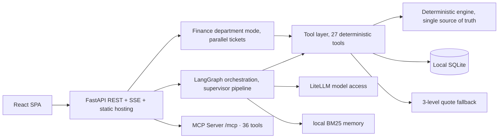

# Moneyhelper

> A conversation-first personal finance assistant. One sentence to record an expense, check quotes, manage positions, run a health check, or get your morning report.


| 简体中文 | English |
|---|---|
| [README.zh.md](README.zh.md) | **README.md (current)** |

## 30-second start

```bash
docker compose up -d --build     # http://localhost:8787
```

```bash
# Or run locally (Python 3.10+ / Node 20.19+): one command — venv + pip install + SPA build + serve on 8788
scripts/dev.sh --prod
```

## Why Moneyhelper

- **Every number comes from a deterministic engine** — the model only classifies intent and writes prose, so it cannot invent an amount.
- **Built for Chinese bills** — WeChat Pay, Alipay and bank CSV imports are native, not an afterthought.
- **Conversation is the operation** — one sentence records an expense, opens a position, or gets a rebalancing plan.
- **Your data stays on your machine** — local SQLite, with optional passphrase-protected encrypted backups.

## What it is

Moneyhelper is **not "a generic chat model + a bookkeeping plugin"** — it is a local-first **vertical finance intelligence workbench**:
a general-model base focused end-to-end on personal / retail / small-business finance decisions — bookkeeping,
position risk control, stock research, corporate statement analysis, strategy backtesting and team paper-trading, every conclusion
visualized and traceable.

Moneyhelper is the helper for your money: a local-first workbench that turns every entry into a decision you can check,
so saving and investing stay deliberate instead of hopeful.

### What makes it different from a generic assistant

| Dimension | Generic LLM assistant | Moneyhelper finance workbench |
|---|---|---|
| Core logic | Text-first; fluency beats accuracy | **Computation-first**: the model narrates, deterministic code computes |
| Financial accuracy | Relies on memorized knowledge; formulas/tax/ratios hallucinate | Metric definitions live in docstrings; insufficient data returns `null` with a reason — never a plausible fake number |
| Capability boundary | Can chat about anything, finance stays "encyclopedia-level" | Finance only, but runs the whole loop: bookkeeping → position risk → research → statements → backtest |
| Interaction | Mostly plain-text chat | Chat + visual workbench: ask once, get charts, tables and conclusions |
| Privacy | Raw data goes to the model provider | Local-first: sensitive data stays in local SQLite, only sanitized structured data leaves the machine |
| Workflow | Single-turn Q&A, no persistent state | Persistent finance workspace: assets, positions, statements, backtests survive across sessions |

| You say | Moneyhelper does |
|---|---|
| "coffee 28, taxi 32" | Records two entries in one sentence |
| "salary 1w credited" | Records income 10000 (supports 万/w/k and Chinese numerals) |
| "check CATL, add to watchlist if good" | Quote → add to watchlist → visible on Market |
| "buy 100 shares of 600519" | Opens a position at the current price (asks for cost when quotes are unavailable) |
| "sell half of 600519" | Half-position sell, never an accidental full liquidation |
| "analyze the technicals of 600519" | Research tab: K-line + MA/MACD/RSI/BOLL/KDJ + signal stream + bias |
| "how does a MA cross-over strategy do on 600519" | Research tab: backtest with return/drawdown/Sharpe/win rate + equity curve |
| "here are two years of statements" | Statements tab: 20+ metrics, DuPont, trend charts, radar, anomaly alerts |
| "open paper accounts for the team, who performs best" | Paper Trading tab: open account → trade (lot/fee checks) → NAV curve + team ranking bars |

The other tabs (Overview / Holdings / **Research** / **Statements** / **Paper Trading** / Strategy / Market / Ledger / Health)
are views of the conversation results, not duplicate form entries.

## Core features

- **100% local data**: everything lives in a local SQLite database. Optional passphrase-protected encrypted backups (PBKDF2 + Fernet); the passphrase is never stored.
- **Never fabricates numbers**: amounts, P&L, risk metrics, technical indicators, backtest results and statement ratios are all computed by deterministic engines; the model only classifies and writes prose. At runtime the model only sees read-only tools.
- **Domestic models first**: unified access via LiteLLM, defaulting to DeepSeek / Doubao / Qwen / Kimi — zero friction on Chinese platforms. Fully usable without any model configured.
- **Multi-agent orchestration**: a LangGraph graph (supervisor pipeline), plus a "finance department mode" that splits one request into tickets, runs departments in parallel, and summarizes for approval.
- **MCP protocol**: all finance tools are exposed as a standard MCP Server via fastmcp — Cursor / Claude Code can query your local data directly.
- **Stock research engine**: technical indicators (MA/MACD/RSI/BOLL/KDJ) + rule-based signal synthesis + bull/bear bias; **statistical forecasting** (linear trend + Monte-Carlo GBM percentile band, fixed reproducible seed); MA-cross and DCA strategy backtests (return, annualized, drawdown, Sharpe, win rate, profit factor, equity curve, trade details).
- **Statement analysis engine**: paste three-statement JSON → 20+ metrics (profitability / solvency / efficiency / growth / cash-flow quality) + DuPont decomposition + YoY trends + three-cashflow structure + rule-based anomaly alerts (goodwill, receivables, inventory, cash quality…) + a templated report.
- **Investment strategy engine**: portfolio risk metrics (volatility / Sharpe / Sortino / max drawdown / Beta / VaR) against a benchmark, target-allocation rebalancing, valuation percentile, DCA plans and FIRE progress.
- **Long-term memory**: preferences live in a local table and are recalled with BM25; memory never leaves the machine.
- **3-level quote fallback**: Eastmoney → Sina → local snapshot, clearly labeled when offline.
- **PWA**: installable on desktop and mobile.

## Interface

Two surfaces, each with a clear job:

- **Chat** is the entry point — record an expense, ask a question.
- **Finance workbench** follows stock-broker conventions: nine tabs, each a decision dashboard of
  "metric strip + chart + detail table".

Navigation: a persistent session sidebar (chat) plus nine top tabs
(Overview / Holdings / **Research** / **Statements** / **Paper Trading** / Strategy / Market / Ledger / Health).
The main area switches pages; "Back to chat" returns to the conversation.

| Width | Layout |
|---|---|
| ≥1280 | Session sidebar (drag to resize) + main area (chat centred at 48rem, finance pages at 1200px) |
| 768–1279 | Sidebar kept; finance two-column layouts collapse to one |
| <768 | Compact top bar + five bottom tabs (Chat / Finance / Holdings / Scheduled / Settings), rest in a drawer |

Highlights:
- Holdings: summary strip → concentration warnings → table + P&L contribution chart, with
  concentration / sector / risk columns on the right.
- **Research**: quote strip → technical metric cards (MA alignment / RSI / MACD / BOLL / KDJ) →
  zoomable candlestick chart (A-share red-up/green-down, MA + BOLL overlay toggle, daily/weekly/monthly) →
  signal stream → **statistical forecast panel** (trend line + Monte-Carlo 5%-95% band) →
  strategy backtest (MA-cross / DCA switch, tunable params, metric strip + equity curve + trade log).
- **Paper Trading**: team virtual accounts with event-sourced positions — open account, trade (A-share lots, commission + stamp tax), per-account NAV curves, holdings donut, and team ranking bars
- **Statements**: three-statement JSON input (with sample) → four metric-card groups →
  revenue & net profit / margin / solvency / cash-flow trend charts → three-cashflow stacked chart +
  DuPont bar chart → five-dimension financial radar → multi-period comparison table →
  anomaly alert stream → templated report → local save & re-analyze.
- Strategy: portfolio risk metrics and equity curve vs benchmark, rebalance checklist, valuation
  percentile, DCA plans and FIRE progress.
- Market: watchlist and holdings with 60-day sparklines, plus a detail panel (trend, period change,
  60-day high/low, full K-line).
- Ledger: one-sentence entry plus a standard transaction table.
- Health: score, five-dimension bars, a "fix first" list, and per-dimension advice.
- Settings uses a left nav with three groups on desktop and a horizontal segmented bar on mobile
  (Basics / AI & automation / Data & security).
- Sidebar width is remembered (localStorage), double-click the divider to reset; panels trap and
  restore focus, Esc closes.
- Only chat code loads on first paint; charts / research / statements / department board / inbox are lazy-loaded.

Screenshots: `cd frontend && node scripts/ui-audit.mjs` (every page, into `out/ui-audit/`);
README images: `node scripts/readme-shots.mjs` (writes `docs/screenshots/`).

## Screenshots

| Chat | Answer: plan + snapshot + actions |
|---|---|
|  |  |

| Overview | Holdings |
|---|---|
|  |  |

| Market: list + detail | Ledger |
|---|---|
|  |  |

| Health check | Settings |
|---|---|
|  |  |

| Command palette (Ctrl+K) | Dark mode |
|---|---|
|  |  |

| Mobile: chat | Mobile: finance |
|---|---|
|  |  |

| Investment strategy: risk / rebalance / valuation / DCA / FIRE |
|---|
|  |

More in [docs/screenshots/](docs/screenshots/).

## Quick start

Requirements: Python 3.10+, Node.js 20.19+.

**Fastest path (Docker)**

```bash
docker compose up -d --build   # single container, port 8787, volume moneyhelper-data
```

**One-click (recommended for development)**

```bash
scripts/dev.sh        # Windows (Git Bash) / macOS / Linux — backend 8788 + frontend 5198
scripts/dev.sh --prod # production mode: build once, serve on a single port
start.bat             # Windows: creates the venv, installs deps, opens two windows
start.bat --prod      # Windows production mode: one window, one port
```

The scripts create the virtualenv, install dependencies and check port conflicts; they pick
`Scripts/` or `bin/` automatically per platform.

**Manual**

```bash
# Backend (run inside backend/)
cd backend
python3 -m venv .venv && .venv/bin/pip install -r requirements.txt
cp .env.example .env   # optional: fill LLM_* to enable a model
.venv/bin/python -m uvicorn app.main:app --host 127.0.0.1 --port 8788

# Frontend dev mode (/api proxied to 8788)
cd frontend
npm install && npm run dev    # http://127.0.0.1:5198

# Or production mode: build once, served by the backend on one port
cd frontend && npm run build  # then open http://127.0.0.1:8788
```

The database lives at `backend/data/wealth.db` by default (`MONEYHELPER_DATA_DIR` / `MONEYHELPER_DB_PATH` override it; empty values fall back to the default).

A fresh database starts empty with chat-style onboarding; everything works without an AI key.

## Tech stack

| Layer | Tech |
|---|---|
| Frontend | React 19 + Vite + Tailwind 4 · ECharts · TanStack Table · PWA |
| Backend | FastAPI + LangGraph multi-agent orchestration + deterministic engine |
| Data | SQLite (aiosqlite + WAL) · encrypted backups (PBKDF2 + Fernet) |
| AI | LiteLLM unified access · local BM25 long-term memory · fastmcp |
| Quotes | Eastmoney → Sina → local snapshot, 3-level fallback |

## Architecture



Principle: **the framework orchestrates; the engine computes**. The model only appears at classification and finalization; any failure degrades to the deterministic path. Full architecture with diagrams: [docs/architecture.md](docs/architecture.md).

Key invariants:
- Write tools are invisible to the model (removed at both schema and implementation layers); the model cannot edit the ledger.
- Amounts, P&L and risk metrics are computed only by `analysis` / `calculations`.
- Long-term memory is fully local (BM25); memory content never leaves the machine.
- Confirmable write actions use atomic claiming (`claim_pending_action`), so a token executes exactly once.

## Repository layout

```
backend/app/
  main.py            FastAPI entry: REST + SSE + auth + static hosting
  db/                Data layer (domain modules): ledger / portfolio / budgets /
                     debts / goals / memory / history / audit / backup / users ...
  routes/            Routes: budgets / settings / goals / market / import ...
  agents/            Multi-agent config: supervisor / bookkeeping / portfolio
  agent_graph.py     LangGraph graph: supervisor + specialized nodes + routes
  department.py      Finance department mode: tickets → parallel → summary
  analysis.py        Deterministic engine: positions / cashflow / debt / risk
  calculations/      Portfolio risk / rebalance / valuation / DCA / FIRE models
  tools.py           Agent tool layer: 27 function-calling tools
  quotes.py          Quotes: Eastmoney → Sina → snapshot fallback + cache
  nlparse.py         One-sentence bookkeeping: rule engine + AI fallback
  llm.py             LiteLLM unified model access
  mem.py             long-term memory (local BM25, no network)
  mcp_server.py      MCP Server exposing finance tools
  backup.py          Local encrypted backup, passphrase never stored
frontend/src/
  App.tsx            Adaptive layout: resizable sidebar on desktop / bottom nav on mobile
  components/        ChatView / Dashboard / HoldingsView / MarketView ...
  lib/               api / store / i18n (zh+en) / charts / format
docs/                Deploy / config / workflow / architecture / planning
```

## Docs

| Doc | Contents |
|---|---|
| [Quick start](docs/quickstart.md) | Up and running in 5 minutes |
| [Deployment](docs/DEPLOY.en.md) | Local / Docker / external access / backup migration ([中文](docs/DEPLOY.md)) |
| [Configuration](docs/CONFIG.en.md) | Env vars + settings + AI endpoint cheat-sheet ([中文](docs/CONFIG.md)) |
| [Workflows](docs/WORKFLOW.en.md) | Every conversation pattern ([中文](docs/WORKFLOW.md)) |
| [Architecture](docs/architecture.md) | Mermaid diagrams + department mode + data reliability |
| [CLI](docs/cli.md) | `moneyhelper add / ls / report / balance / ask` — offline-first, same commands in local or remote mode |
| [Module map](docs/module-map.md) | Every backend module: size, structure, responsibility |
| [Development guide](docs/DEVELOPMENT.en.md) | Code map + add-tool/setting tutorials + release flow ([中文](docs/DEVELOPMENT.md)) |
| [Progress](docs/PROGRESS.md) | What is done, what is left, in one page |
| [Roadmap](docs/ROADMAP-v3.md) | v3 direction → [detailed plan](docs/PLAN-DETAILED.md) |
| [Planning archive](docs/planning/) | Reviews / differentiation / research docs |
| [Changelog](CHANGELOG.md) | Full version history |

## Tests

```bash
# Backend: 906 tests (engine / strategy / quote fallback / agent loop / LangGraph / API / backup / MCP ...)
cd backend && .venv/bin/python -m pytest tests -q
cd backend && .venv/bin/python -m ruff check app tests

# Frontend: tsc + build + 111 unit tests + 21 Playwright e2e specs
cd frontend && npm run build
cd frontend && npm run test:e2e
```

CI covers backend ruff (app + moneyhelper package) + pytest, frontend tsc + vitest + build,
plus a hygiene job: no files over 1MB, and `mkdocs build --strict` must pass.

## Data & privacy

- All personal data lives in local SQLite; quotes use public Eastmoney/Sina endpoints; model calls go only to the endpoint you configured.
- Encrypted backups recommended; plaintext export shows a strong warning. No telemetry, no tracking, no third-party analytics.
- Auth: when `API_TOKEN` is set, all `/api/*` require `Bearer` or `?token=`; without a token, only localhost and the `ALLOWED_HOSTS` allowlist are accepted.

## Disclaimer

Everything this software outputs (health checks, reports, AI answers, suggestions) is for reference only and does not constitute investment advice. Markets carry risk.

## Contributing

- License: [MIT](LICENSE) · [CONTRIBUTING.md](CONTRIBUTING.md) · [CODE_OF_CONDUCT.md](CODE_OF_CONDUCT.md) · [SECURITY.md](SECURITY.md)
- Issues and PRs welcome; please pair new features with tests and pass the test commands above before submitting.

**Topics**: `personal-finance` `finance-assistant` `ai-agent` `langgraph` `fastapi` `react` `sqlite` `local-first` `mcp` `pwa`
