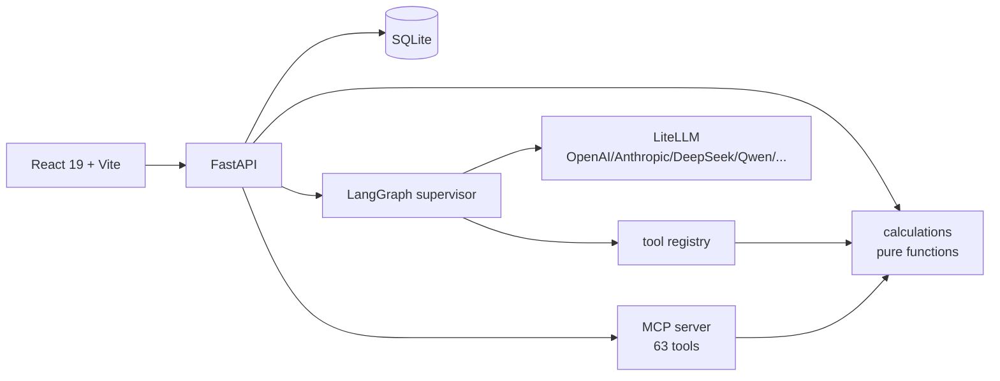

# Moneyhelper

**An auditable AI finance department.** Bookkeeping, enterprise ledger, procurement/payables, expense claims, bank reconciliation, portfolio risk, statements and tax — every number is computed by deterministic code; the model only writes prose.

[English](README.md) · [简体中文](README.zh.md) · [Docs](docs/index.md) · [CLI](docs/cli.md) · [Deploy](docs/DEPLOY.en.md)

[](https://github.com/badhope/moneyhelper/actions/workflows/ci.yml)
[](https://github.com/badhope/moneyhelper/releases)
[](#verification)
[](LICENSE)
[](pyproject.toml)
[](docs/mcp-guide.md)

<p align="center">
  
</p>
<p align="center">
  
  
</p>
<p align="center">
  
  
</p>

---

## Install

```bash
# 1) Desktop — download and run, no Python needed
#    release assets: moneyhelper-windows-x64.exe / moneyhelper-macos-arm64 / moneyhelper-linux-x64

# 2) Docker
docker compose up -d                 # → http://localhost:8787

# 3) From source
scripts/dev.sh --prod                # venv + pip + frontend build + serve on :8788
pip install -e . && moneyhelper add "lunch 45, taxi 28"
```

Requires Python 3.10+ and Node 20.19+ for the source install. Data lives in a local SQLite file — no account, no telemetry, no cloud round-trip.

---

## What it does

| Area | Capability |
|---|---|
| **Enterprise foundation** | Tenants, departments, positions, memberships; tenant-scoped permissions with a role → permission dictionary. |
| **Double-entry ledger** | Chart of accounts, accounting periods, journal entries and lines in integer cents, draft → post → reverse, trial balance, period lock. |
| **Expense claims** | Draft → submit → approve; applicant ≠ approver in enterprise tenants; approval creates a voucher draft. |
| **Procurement / payables** | Vendor → purchase order → payable → payment. PO approval grants the purchase; payable approval creates the voucher; payment creates the bank-side voucher. |
| **Bank reconciliation** | Payment records, manual/CSV bank statements, match/unmatch by account + amount + direction, statement vs book balance, sign-off gates. |
| **Personal ledger** | One sentence, many entries: `午餐 45 打车 28` becomes two transactions. WeChat Pay, Alipay, bank CSV, PDF statements, invoice QR and OCR import natively. |
| **Portfolio & research** | Positions, concentration, P&L attribution, rebalance orders, technical indicators, 5 backtest strategies, seeded Monte Carlo scenarios. |
| **Statements & tax (CN)** | Three-statement analysis with 20+ ratios and DuPont decomposition; VAT, corporate income tax, cumulative withholding, payroll with social insurance. |
| **Long tasks** | Staged execution for work that does not fit one answer: novel, web app, Word report, paper, program. Each stage is persisted, resumable, and inspectable. |
| **Reports & MCP** | Single-file offline HTML reports; 63 tools exposed over the Model Context Protocol. |

---

## Why the numbers hold up

The calculation layer is pure functions: no network, no database, no unseeded randomness.

```
question → intent routing → tool call → calculations/*.py (pure functions)
                                              ↓
                                     numbers filled in → model only writes prose
```

**The model has no channel for inventing numbers.** It receives computed values and can only phrase them. Every figure carries a provenance record; every metric documents its formula and failure modes — when a sample is too small the API returns `null` with a reason instead of a plausible-looking number.

Regression tests assert observable output (values, dates, codes, series lengths), not implementation details. When RSI(14) returned `0.00` for a 60-day straight uptrend and fired a "deeply oversold" signal, the fix came with a test that fails on the old behavior.

---

## Permissions & safety

This is a local-first application, and it is built so that **the program cannot rewrite itself by accident**:

- **Instance-admin boundary.** Changing Studio permission modes, agent roles/skills, system prompts, model endpoints, MCP servers and backup restore requires the instance administrator. Tenant members cannot escalate themselves to "open".
- **Protected program directories.** A path guard refuses to point the data directory or database at source code, `.git`, dependency manifests or startup scripts. Overriding it requires an explicit `MONEYHELPER_ALLOW_SYSTEM_ACCESS=1`.
- **stdio MCP is off by default.** Market installs may register a command entry, but enabling or spawning it requires `MONEYHELPER_ALLOW_STDIO_MCP=1`; working directories inside the source tree are rejected.
- **Backup restore is narrow.** Only user preferences are restored from a backup; permission modes, prompts, model endpoints and API keys are never written back, and MCP URLs are re-validated against SSRF rules.
- **Safety hooks cannot be disabled.** The built-in hooks that block shell/file-write tools and audit write operations are protected from disable and delete.
- **Live trading is never automatic.** Pre-trade checks produce a confirmation token; live orders generate a handoff sheet. The default broker is `NullBroker` in dry-run.

---

## Verification

```bash
bash scripts/verify-all.sh                        # ruff + backend + frontend + build
bash scripts/verify-all.sh --with-e2e             # + 33 Playwright UI flows
bash scripts/verify-all.sh --with-e2e --with-live # + real-model acceptance (LLM_API_KEY)
```

Current results:

| Layer | Result |
|---|---|
| Backend | `1719 passed, 0 skipped` |
| Frontend | `195 passed`, production build clean |
| Browser E2E | `33 passed` — bookkeeping, chat, settings (24 sections), Studio, tenant switch, procurement → payment, all finance pages |
| Real model | 50-question finance eval `46/50` (91.5%), function calling and multi-turn verified |

Three user-facing paths each have an automated gate — a green unit test proves the function is correct, not that the user can reach it:

| Gate | What it proves |
|---|---|
| HTTP | every OpenAPI endpoint probed for 5xx; 4xx responses carry readable text, not a stack trace |
| MCP | tool surface matches the registry, and a real protocol call succeeds via the SDK client |
| Render | seeded hostile data (10.8k-char names, ±Infinity, epoch dates) renders with zero page errors and zero overflow |

---

## Architecture



```
backend/app/
  calculations/    deterministic engine — no I/O, unit-testable in isolation
  routes/          HTTP layer: parameter cleaning and assembly only
  db/              domain-split SQLite access, migrations, undo snapshots
  import_parsers/  WeChat / Alipay / generic CSV / PDF / invoice decoders
  agents/          supervisor + bookkeeping + portfolio + research
moneyhelper/       stable facade packages (core / server / cli / mcp)
frontend/src/      React UI, lazy-loaded per section
```

Full detail: [architecture.md](docs/architecture.md) · [module-map.md](docs/module-map.md)

---

## Boundaries

- Does not place live trades; generates a handoff sheet and requires confirmation.
- Does not give tax-planning advice; applies published formulas and labels the result as an estimate.
- Does not predict returns; backtests state their assumptions and failure conditions.
- Optional features (OCR, PDF parsing, broker SDKs) degrade with an install hint rather than failing silently.

MIT License · [Security](SECURITY.md) · [Contributing](CONTRIBUTING.md) · [Changelog](CHANGELOG.md)
