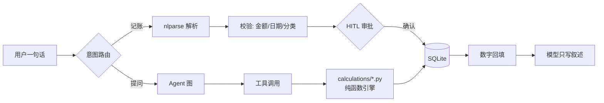

# Moneyhelper

**会算账的 AI 财务助手。** 一句话记账、看持仓、做体检、出晨报。
所有数字来自确定性引擎，模型只负责理解意图与写话——**它编不出金额**。

[](https://github.com/badhope/moneyhelper/releases)
[](#工程基线)
[](https://python.org)
[](https://react.dev)
[](LICENSE)

简体中文 | [English](README.en.md) | [架构详解](docs/ARCHITECTURE-detail.md)

---

## 三个形态，一套内核

| 形态 | 启动方式 | 适合谁 |
|---|---|---|
| **桌面安装包** | 下载 `.exe` / `.msi` / `.dmg` / `.AppImage` | 只想双击打开，不碰命令行 |
| **Web + 后台** | `docker compose up -d` → `localhost:8787` | 自建服务器、多设备访问 |
| **CLI** | `moneyhelper add "咖啡 28"` | 键盘党、脚本集成 |

```bash
# 本地开发（一条命令：venv + 依赖 + 前端构建 + 起服务）
scripts/dev.sh --prod        # → http://localhost:8788

# CLI
moneyhelper add "午餐 45 打车 28"    # 一句话多笔自动分类
moneyhelper balance                  # 净资产 + 持仓
moneyhelper ask "这个月花在哪"        # 走完整问答管线
```

---

## 它解决什么问题

大多数人不是缺记账工具，是**缺结论**。

| 你的困惑 | Moneyhelper 的回答 |
|---|---|
| 这个月钱花哪了？ | 分类构成 + 环比 + 异常项 |
| 净资产涨了，是存的还是涨的？ | 净储蓄 / 投资损益 / 负债变动 拆开给你 |
| 我的持仓安全吗？ | 集中度、行业分布、越线标红 |
| 我该先做什么？ | 按紧急度排序的行动清单（不是指标罗列） |

**核心差别**：不是再给你一个仪表盘，而是把「数据 → 判断 → 下一步动作」串起来。

---

## 关键能力

### 账本与持仓

- **一句话多笔**：`午餐 45 打车 28 工资 8000` → 三条流水，自动分类
- **写入选代确认**：写操作走 HITL（人在环）审批，确认前不落库；重复确认被幂等拦住
- **追加与加权成本**：再买同一标的自动累加股数、按股数加权成本（不覆盖原持仓）
- **净值序列与归因**：每日快照，把变动拆成「存的 / 涨的 / 还债的 / 其他」

### 分析与决策

- **决策中心**：风险标记 + 目标进度 + 税负机会 → 按紧急度排序的行动清单，一键跳转
- **财务体检**：五维评分（配置/现金流/负债/应急金/目标），缺失维度标 `unknown` 而非送分
- **回测 → 模拟盘闭环**：策略回测后转模拟盘跟踪，输出跟踪误差与「是否已失效」
- **集中度体检**：单标的、行业多维度越线检测

### 报告与导出

- **单文件 HTML 报告**：零外部依赖、断网可看、可打印为 PDF，内联 SVG 图表
- **加密备份**：PBKDF2 派生 + Fernet，口令不进磁盘

---

## 确定性内核（为什么它不会算错）



**三层隔离**：

1. **计算层**（`calculations/`，20 个模块）—— 纯函数、无 I/O、可单测，所有数字出自这里
2. **编排层**（`agent_graph.py`）—— LangGraph 状态机，中断/恢复/检查点落盘
3. **叙述层**（`llm.py`）—— 模型只拿到「已算好的数字」写文案，无法反向影响计算

> 这就是为什么它敢说「AI 编不出金额」：模型根本没有写数字的通道。

---

## 工程基线

| 维度 | 现状 |
|---|---|
| 后端测试 | **1,400+ 通过**（含口径一致性、并发、租户隔离） |
| 前端测试 | **140+ 通过**（19 个文件） |
| 类型检查 | `tsc --noEmit` 零错误 |
| 浏览器验证 | 14 张真实截图（桌面 7 + 移动 7），零横向溢出、零控制台错误 |
| 安全 | SSRF 防护、工具权限三档、租户隔离、审计链 |

**测试原则**：测「口径与不变量」，不测「字符串」。例如归因必须满足
`储蓄 + 投资损益 + 负债变动 + 残差 = 总变动`，任何情况下不平即失败。

---

## 架构速览

```
backend/app/
├── calculations/        20 个纯函数引擎（风险/税负/回测/健康/组合…）
├── routes/              33 个路由模块，264 个端点
├── agent_graph.py       LangGraph 状态机（HITL + 检查点）
├── context.py           token 计量 + LLM 摘要压缩
├── tool_policy.py       工具权限三档（read/ask/deny）
├── netguard.py          SSRF 防护
├── networth_series.py   净值快照与归因
├── report.py            自包含 HTML 报告
└── db/                  33 个数据访问模块，全租户隔离
```

详见 [架构详解](docs/ARCHITECTURE-detail.md)。

---

## 快速上手（Docker）

```bash
git clone https://github.com/badhope/moneyhelper.git
cd moneyhelper
cp .env.example .env          # 可选：填 LLM_API_KEY 启用 AI
docker compose up -d --build
open http://localhost:8787
```

**不接模型也能用**：所有计算、记账、体检、报表都是确定性的，模型只影响「自然语言对话」这一层。没配 Key 时自动降级到模板叙述，功能不缺。

---

## 配置

最小配置（`.env`）：

```ini
# 可选：不填则用模板叙述
LLM_API_KEY=sk-...
LLM_MODEL=deepseek-chat
LLM_BASE_URL=https://api.deepseek.com/v1

# 可选：启用访问口令
API_TOKEN=your-secret

# 可选：数据目录（默认 ./data）
MONEYHELPER_DATA_DIR=./data
```

完整配置见 [CONFIG.md](docs/CONFIG.md)。

---

## 边界与诚实清单

这个项目**不做什么**：

- ❌ 不代客下单。实盘只生成交接单，最后一键必须你自己点
- ❌ 不做税务筹划建议。税负计算是「按公式算给你看」，不是「教你避税」
- ❌ 不保证收益预测。回测与预测都标注了假设与失效条件
- ✅ 离线可用：记账/分析/报表不依赖网络，只有实时行情需要

已知限制见 [SECURITY.md](SECURITY.md) 与 [docs/REVIEW-FINDINGS.md](docs/REVIEW-FINDINGS.md)。

---

## 贡献与许可

- [贡献指南](CONTRIBUTING.md) · [行为准则](CODE_OF_CONDUCT.md) · [安全策略](SECURITY.md)
- MIT License — 见 [LICENSE](LICENSE)

**做财务软件的第一原则：宁可说「不知道」，也不给一个看起来专业的错数字。**
