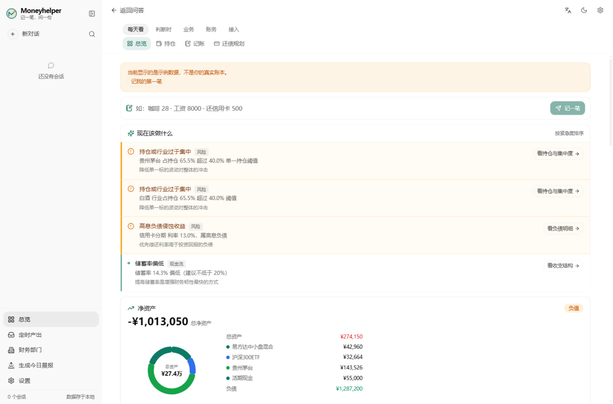
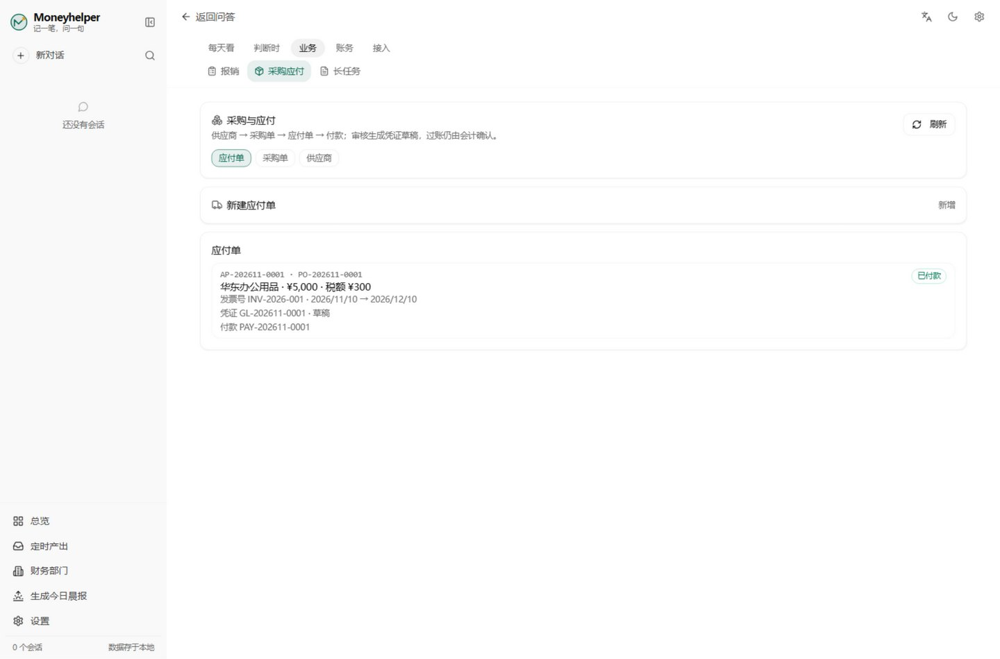
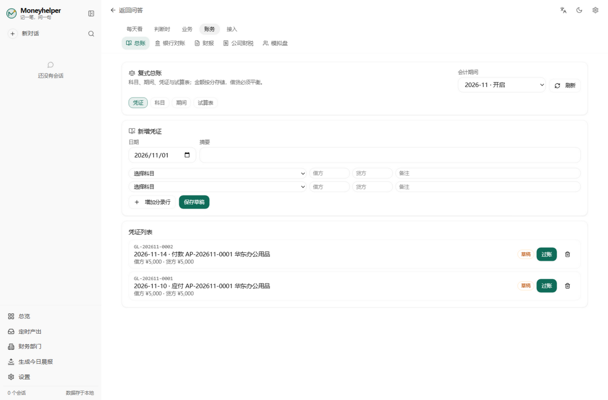
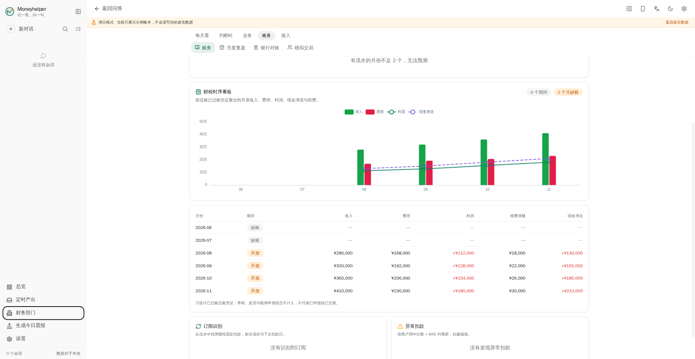
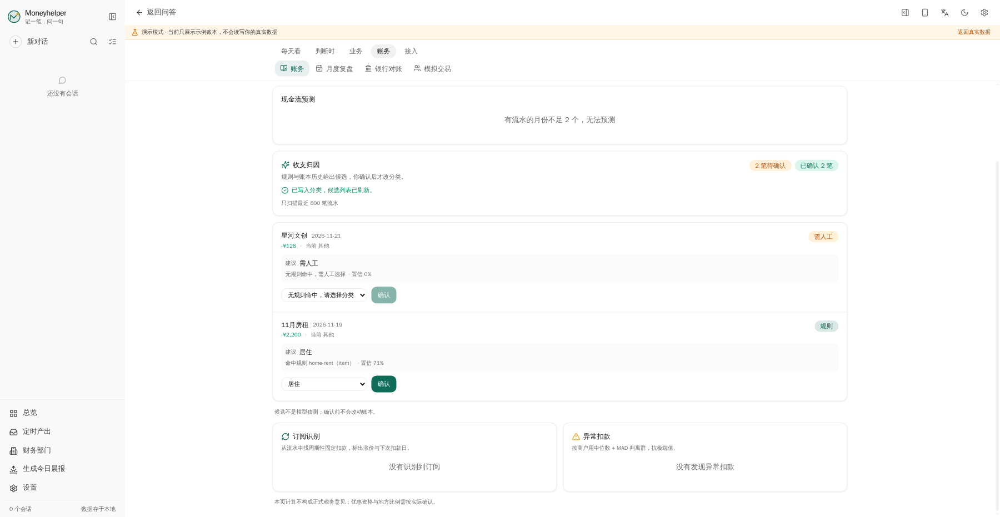
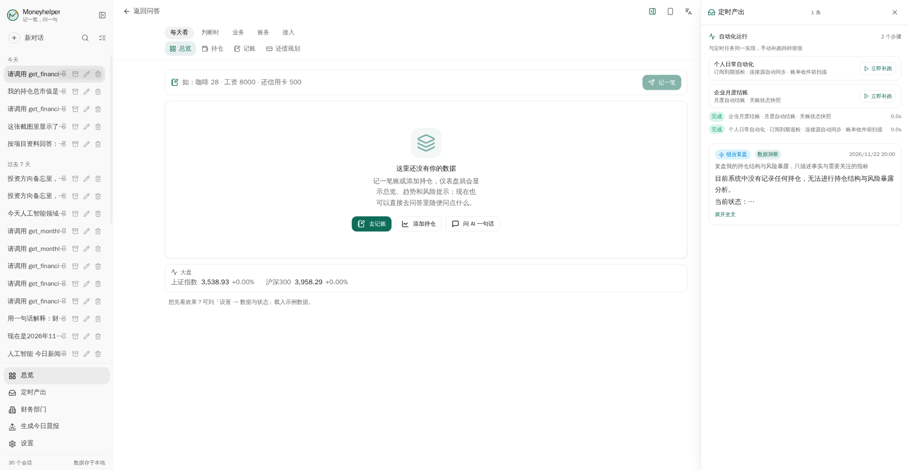
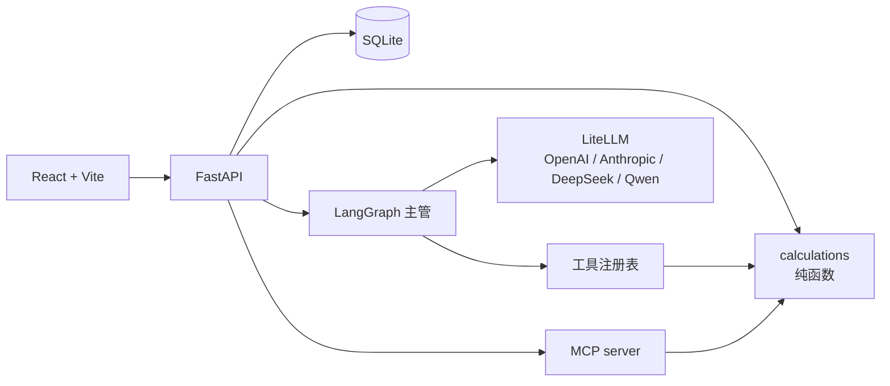

# Moneyhelper

自托管的财务软件，把账替你记完。你写一句话，它记账、对银行流水、月末结账，最后给出的数字来自代码，不是来自语言模型。

[English](README.md) · [简体中文](README.zh.md) · [文档](docs/index.md) · [命令行](docs/cli.md) · [部署](docs/DEPLOY.md)

[](https://github.com/badhope/moneyhelper/actions/workflows/ci.yml)
[](LICENSE)

<p align="center">
  
</p>
<p align="center">
  
  
</p>

---

## 只有一件事要说清

绝大多数「AI 财务」产品让模型来算数字。财务恰恰是最不能靠发挥的地方。

这里的顺序反过来：确定性计算引擎把每个数字填好，模型只负责把它说成人话。模型没有任何通道可以编造数字——不在提示词里做算术，不把估算伪装成结果。样本不够时接口返回 `null` 并说明原因，而不是给一个看起来合理的数。

```
提问 → 意图路由 → 工具调用 → calculations（纯函数）
                                  ↓
                        数字填好 → 模型只写措辞
```

每个数字都带溯源记录：哪个工具、什么参数、走了哪段代码。

---

## 它能做什么

**个人。** 一句话变成多笔账——`午餐 45 打车 28` 是两笔交易，不是一笔。微信、支付宝、银行流水 CSV、PDF 对账单、发票二维码与 OCR 都在原生导入范围内。持仓、集中度、再平衡、回测与月度报告落在同一本账里。

**企业。** 多租户、部门与成员。真正的复式总账：科目、期间、凭证、草稿 → 过账 → 冲销、试算表、关账锁定。报销要求申请人与审批人不是同一人。采购走完供应商 → 采购单 → 应付 → 付款，每步生成对应的凭证。银行对账按账户、金额、方向匹配，给出账面与对账单差异和签字关闸。

两边共用同一个引擎，所以家庭账与公司账遵守同一套会计规则——一个安装可以同时装住家庭和企业，互不串味。

**无人值守，而且每次运行都有台账。** 月末结账按计划自动过账草稿并关账。定时导入、异常扫描、晨报不需要等你点。长周期工作——报告、论文、小型网页应用——按阶段执行，每阶段留可续跑的产物。

**可审计的财税时序，以及必须由你确认的归因。** 报税助手只读已过账凭证，按月聚合收入、费用、利润、现金流入流出与税费计提；缺账月份显式标出，不用 0 冒充已结账。收支归因从规则表或账本历史给出候选，展示规则 id、命中词与置信度，确认前不改账；确认动作、前后分类与规则依据都会留痕。

<p align="center">
  
  
</p>

**可以被你自己的 Agent 调用。** 同一套能力通过 MCP 暴露，Claude、Codex 或任何 MCP 客户端都能在你授权下操作账本。

---

<p align="center">
  
</p>

## 快速开始

```bash
# Docker
docker compose up -d            # → http://localhost:8787

# 从源码（Python 3.10+、Node 20.19+）
scripts/dev.sh --prod           # 建 venv + 依赖 + 前端构建，跑在 :8788

# 命令行
pip install -e .
moneyhelper add "午餐 45 打车 28"
```

安装包与单文件可执行程序见 [Releases](https://github.com/badhope/moneyhelper/releases)。数据存在本地 SQLite 文件里：不要账号、不上报、不走云端往返。

---

## 手机远程控制

顶栏点手机图标，生成一条连接码（链接 + 二维码）。手机扫码后进入的是同一套界面，不是另做一个「远程聊天页」：会话、文件、预览、浏览器右栏、财务页、设置页都能操作。手机只是控制面，数据和执行都留在电脑上。

- 链接里的令牌放在 `#` 后面，浏览器不会把它发给服务器，也不进访问日志；10 分钟内有效，配对一次即作废。
- 配对成功后换成 `HttpOnly` 设备 cookie，默认 12 小时，可设 1–168 小时。关闭面板不会断开，点「停止」才会立即撤销；点「刷新二维码」会让旧链接立刻失效，并把已连设备踢下线。
- 「对外地址」填手机能访问到的地址：局域网填 `http://192.168.x.x:8788`，公网填 `https://money.example.com`。面板检测到 `127.0.0.1` 会直接警告「手机扫码访问不到」。
- **没有公网 IP 也能用**：在一台公网服务器跑 `python -m app.relay.server`，远程面板填 `ws://` 控制地址和口令，桌面端主动出站连接；中继分配一个公网端口，手机扫码直连。账本只经过你自己的中继，不经过第三方。

## 它故意不做的事

- **不自动下实盘单。** 预交易检查只产出确认令牌，实盘下单只生成交接单。默认券商是空实现。
- **不给税务筹划建议。** 只套用已公布的公式，并把结果标注为估算。
- **不把预测当事实。** 回测写明假设，也写明它在什么条件下失效。
- **不静默失败。** OCR、PDF 解析、券商 SDK 这类可选能力缺失时会给出安装提示，而不是假装能用。

---

## 为什么敢让它无人值守，而且每次运行都有台账

本地优先，并且刻意做成「程序没法悄悄改写自己」：

- 改权限档、Agent 角色、系统提示词、模型端点、MCP 服务与备份恢复，都需要实例管理员身份。
- 路径守卫拒绝把数据目录指向源码、`.git` 或依赖清单。
- `stdio` 形式的 MCP 默认关闭；工作目录落在源码树内会被拒绝。
- 备份恢复只带回偏好设置，从不写回权限档、提示词、端点或密钥。
- 审计写操作的内置钩子不能被禁用或删除。

---

## 自己验证

```bash
bash scripts/verify-all.sh                          # 静态守卫 + 后端 + 前端 + 构建
bash scripts/verify-all.sh --with-e2e                # + Playwright：每个页面、每个设置分区
bash scripts/verify-all.sh --with-e2e --with-live    # + 真实模型验收（需要 LLM_API_KEY）
```

单测通过只证明函数是对的，不证明用户点得到。所以另有三道闸：每个 HTTP 端点都探一遍服务端错误并检查失败文案是否可读；MCP 面通过真实协议客户端调用；用构造的极端数据（超长名称、无穷大、纪元日期）渲染，抓布局崩坏。

---

## 架构



```
backend/app/
  calculations/    确定性引擎——不做 I/O，可单独测
  routes/          HTTP 层：只做参数清洗与组装
  db/              按领域拆分的 SQLite 访问、迁移、撤销快照
  import_parsers/  微信 / 支付宝 / 通用 CSV / PDF / 发票解码
  agents/          主管 + 记账 + 持仓 + 投研
moneyhelper/       对外稳定门面包（core / server / cli / mcp）
frontend/src/      React 界面，按分区懒加载
```

细节：[architecture.md](docs/architecture.md) · [module-map.md](docs/module-map.md) · [MCP 指南](docs/mcp-guide.md)

---

## 文档

| 从这里开始 | |
|---|---|
| [docs/index.md](docs/index.md) | 文档地图 |
| [DEVELOPMENT.md](docs/DEVELOPMENT.md) | 本地开发与约定 |
| [DEPLOY.md](docs/DEPLOY.md) | 部署与配置 |
| [cli.md](docs/cli.md) | 命令行 |
| [mcp-guide.md](docs/mcp-guide.md) | 用 MCP 客户端操作账本 |
| [ARCHITECTURE-detail.md](docs/ARCHITECTURE-detail.md) | 为什么这样分层 |

MIT License · [安全](SECURITY.md) · [贡献](CONTRIBUTING.md) · [行为准则](CODE_OF_CONDUCT.md) · [更新日志](CHANGELOG.md)
