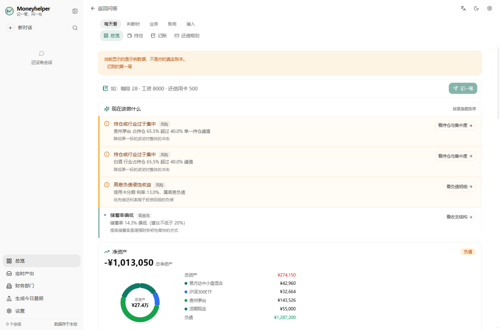
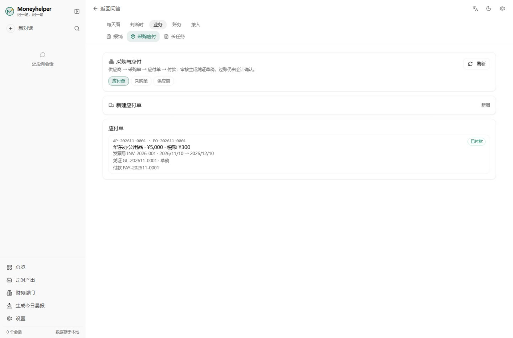
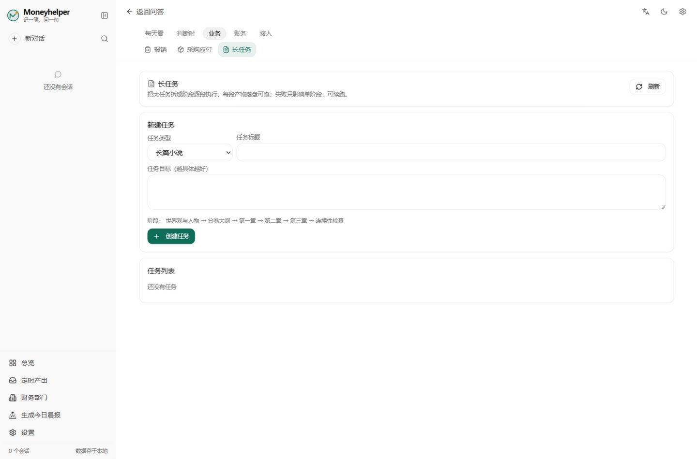
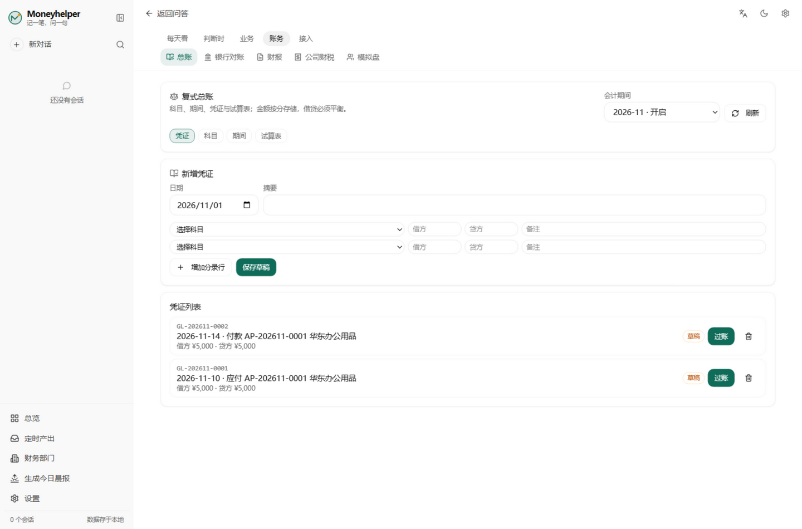
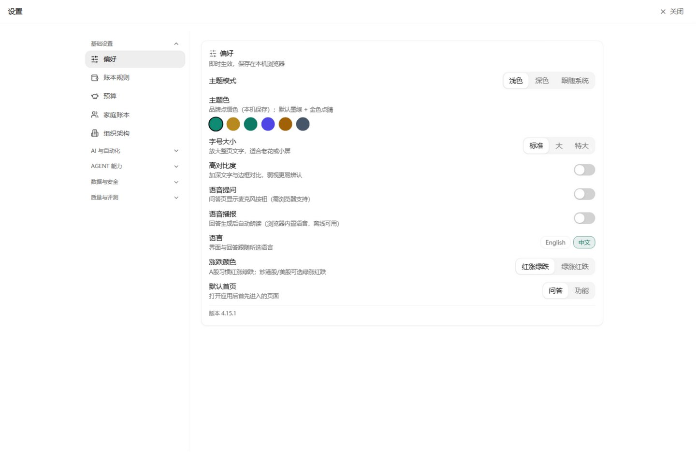
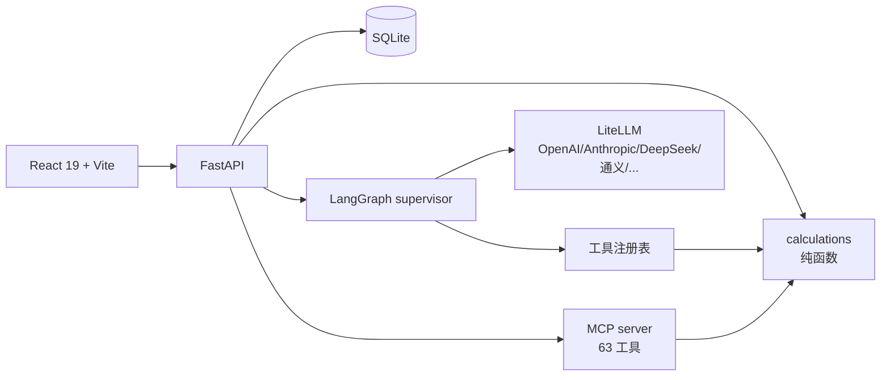

# Moneyhelper

**一个能审计的 AI 财务部门。** 记账、企业总账、采购应付、报销、银行对账、持仓风控、财报与税负——每一个数字都由确定性代码算出，模型只负责把它写成话。

[English](README.md) · 简体中文 · [文档](docs/index.md) · [CLI](docs/cli.md) · [部署](docs/DEPLOY.md)

[](https://github.com/badhope/moneyhelper/actions/workflows/ci.yml)
[](https://github.com/badhope/moneyhelper/releases)
[](#验证)
[](LICENSE)
[](pyproject.toml)
[](docs/mcp-guide.md)

<p align="center">
  
</p>
<p align="center">
  
  
</p>
<p align="center">
  
  
</p>

---

## 安装

```bash
# 1) 桌面版 —— 下载即用，无需 Python
#    release 资产：moneyhelper-windows-x64.exe / moneyhelper-macos-arm64 / moneyhelper-linux-x64

# 2) Docker
docker compose up -d                 # → http://localhost:8787

# 3) 源码
scripts/dev.sh --prod                # venv + pip + 前端构建 + 8788 端口起服务
pip install -e . && moneyhelper add "午餐 45 打车 28"
```

源码安装需要 Python 3.10+ 与 Node 20.19+。数据存在本机 SQLite 文件里：无账号、无遥测、不往云端回传。

---

## 能做什么

| 领域 | 能力 |
|---|---|
| **企业底座** | 租户、部门、岗位、成员关系；租户级权限点与「角色 → 权限」字典。 |
| **复式总账** | 科目、会计期间、凭证与分录（整数分）、草稿 → 过账 → 反冲、试算表、期间锁。 |
| **报销** | 草稿 → 提交 → 审核；企业租户下申请人 ≠ 审批人；审核通过生成凭证草稿。 |
| **采购应付** | 供应商 → 采购单 → 应付单 → 付款。采购审核代表获批；应付审核生成应付凭证；付款生成银行侧凭证。 |
| **银行对账** | 付款登记、手工/CSV 流水、按账户+金额+方向匹配、对账单 vs 账面余额、签核门禁。 |
| **个人记账** | 一句话多笔：`午餐 45 打车 28` 自动拆成两笔。微信、支付宝、银行 CSV、PDF 对账单、发票二维码与 OCR 原生解析。 |
| **持仓与投研** | 持仓、集中度、盈亏归因、再平衡下单量；技术指标、5 种回测策略、固定种子蒙特卡洛。 |
| **财报与税负（CN）** | 三表分析 20+ 指标与杜邦分解；增值税、企业所得税、个税累计预扣、含社保公积金的工资表。 |
| **长任务** | 一次回答装不下的大活儿：小说、网页程序、Word 报告、论文、程序开发。每阶段落盘、可续跑、可逐段查看。 |
| **报表与 MCP** | 单文件离线 HTML 报告；63 个工具通过 Model Context Protocol 暴露。 |

---

## 数字为什么可信

计算层是纯函数：不联网、不读库、不用未固定种子的随机数。

```
问题 → 意图路由 → 工具调用 → calculations/*.py（纯函数）
                                    ↓
                            数字填好 → 模型只写文字
```

**模型没有编造数字的通道。** 它拿到的是算好的值，只能组织语言。每个数字都带来源记录，每个指标都在 docstring 里写明公式与失效条件——样本不足时接口返回 `null` 与原因，而不是一个看起来合理的数字。

回归测试断言可观测输出（数值、日期、编码、序列长度），不断言实现细节。RSI(14) 曾在 60 天单边上涨时返回 `0.00` 并触发"深度超卖"信号，修复时同步补了一条在旧实现上必失败的测试。

---

## 权限与安全

这是本地优先的应用，并且刻意做到**程序不能顺手把自己改掉**：

- **实例管理员边界**：修改 Studio 权限模式、角色/技能、系统提示词、模型端点、MCP 服务器与备份恢复都要求实例管理员。租户成员无法把自己升到「全面放开」。
- **程序自身目录受保护**：路径闸拒绝把数据目录或数据库指向源码、`.git`、依赖清单与启动脚本。要覆盖必须显式设置 `MONEYHELPER_ALLOW_SYSTEM_ACCESS=1`。
- **stdio MCP 默认关闭**：市场安装可以登记命令条目，但启用或拉起进程需要 `MONEYHELPER_ALLOW_STDIO_MCP=1`；工作目录落在源码树内直接拒绝。
- **备份恢复范围收窄**：只恢复用户偏好；权限模式、提示词、模型端点与 API Key 永不写回，MCP 地址重新过 SSRF 校验。
- **安全 Hook 不可停用**：拦截命令执行/文件写入与审计写操作的内置 Hook 禁止停用和删除。
- **不自动交易**：下单预检产出确认令牌；实盘只出交接单。默认券商标为 `NullBroker`，dry-run。

---

## 验证

```bash
bash scripts/verify-all.sh                        # ruff + 后端 + 前端 + 构建
bash scripts/verify-all.sh --with-e2e             # + 33 条 Playwright 界面流程
bash scripts/verify-all.sh --with-e2e --with-live # + 真实模型验收（需 LLM_API_KEY）
```

当前结果：

| 层次 | 结果 |
|---|---|
| 后端 | `1719 passed, 0 skipped` |
| 前端 | `195 passed`，生产构建通过 |
| 浏览器 E2E | `33 passed` —— 记账、问答、设置（24 个分区）、Studio、租户切换、采购 → 付款、全部财务页 |
| 真实模型 | 50 题财务题库 `46/50`（91.5%），function calling 与多轮追问通过 |

三条用户链路各有自动化门禁——单测全绿只证明函数对，证明不了用户够得着：

| 门禁 | 证明什么 |
|---|---|
| HTTP | 逐个探测 OpenAPI 端点无 5xx；4xx 必须带可读文案，不是堆栈 |
| MCP | 工具表面与注册表一致，并用 SDK 客户端跑真实协议调用 |
| 渲染 | 敌意数据（10.8k 字符名称、±Infinity、纪元日期）零页面报错、零溢出 |

---

## 架构



```
backend/app/
  calculations/    确定性引擎 —— 无 I/O，可独立单测
  routes/          HTTP 层：只做参数清洗与组装
  db/              按域拆分的 SQLite 访问、迁移、撤销快照
  import_parsers/  微信 / 支付宝 / 通用 CSV / PDF / 发票解析
  agents/          supervisor + 记账 + 持仓 + 投研
moneyhelper/       稳定门面包（core / server / cli / mcp）
frontend/src/      React 界面，按区块懒加载
```

细节见 [architecture.md](docs/architecture.md) · [module-map.md](docs/module-map.md)

---

## 边界

- 不代客下单；只出交接单并要求确认。
- 不给税务筹划建议；按公开公式计算，结果标注为测算。
- 不预测收益；回测写明假设与失效条件。
- 可选能力（OCR / PDF 解析 / 券商 SDK）缺失时给出安装提示，不静默失败。

MIT License · [安全策略](SECURITY.md) · [贡献指南](CONTRIBUTING.md) · [变更记录](CHANGELOG.md)
