# Moneyhelper

> 对话优先的个人理财助手。记一笔、问一句，记账、行情、持仓、体检、晨报都在对话里完成。


| 简体中文 | English |
|---|---|
| **README.zh.md（当前）** | [README.md](README.md) |

## 30 秒上手

```bash
docker compose up -d --build     # http://localhost:8787
```

```bash
# 或本地跑（Python 3.10+ / Node 20.19+）：一条命令完成 venv + pip 安装 + 前端构建 + 8788 端口启动
scripts/dev.sh --prod
```

## 为什么选 Moneyhelper

- **数字全由确定性引擎算**：模型只负责识别意图与成文，编不出数字。所有金额、指标、回测结果都可溯源、可复核。
- **中国账单原生**：微信支付、支付宝、银行 CSV 直接解析，不是后补的兼容层。
- **对话即操作**：一句话记账、建仓、看调仓建议，不用翻表单。
- **数据留在本机**：本地 SQLite，可选口令加密备份，财务数据不出本机。

## 它是什么

**Moneyhelper 不是「会聊天的通用大模型 + 记账插件」，而是一个本地优先的垂直财务智能体工作台**：
以通用大模型能力为底座，聚焦个人 / 散户 / 小微企业的全场景财务决策——记账管钱、持仓风控、
股票投研、企业财报分析、策略回测、团队模拟盘，所有结论都配可视化、可溯源。

Moneyhelper 意为「管好每一笔钱的帮手」。理财同理：先把每一笔算清楚，日子自然会一步步稳起来。

### 和通用智能体有什么不同

| 维度 | 通用大模型智能体 | Moneyhelper 财务智能体工作台 |
|---|---|---|
| 核心逻辑 | 文本生成优先，怎么通顺怎么来 | **计算优先**：模型只解释叙事，数字全由确定性代码计算 |
| 财务准确性 | 靠训练知识记忆，公式/税率/指标易幻觉 | 指标口径写进 docstring，样本不足返回 null 并标注原因，绝不编数字 |
| 能力边界 | 什么都能聊，财务停留在「科普级」 | 只聚焦财务，但能跑通记账 → 持仓风控 → 投研 → 财报 → 回测全流程 |
| 交互形式 | 纯文本对话为主 | 对话 + 可视化工作台联动，一问出图、出表、出结论 |
| 数据隐私 | 原始数据发往模型服务商 | 本地优先，敏感财务数据只存本机 SQLite，仅脱敏结构化数据出机 |
| 工作流 | 单轮问答，无持久化状态 | 财务工作区持久化，资产、持仓、财报、回测结果跨会话留存 |

### 对话只是入口，工作台才是主场

| 你说 | Moneyhelper 做 |
|---|---|
| 「咖啡 28，打车 32」 | 一句话记两笔账 |
| 「工资 1w 到账」 | 记收入 10000（支持 万/w/k 与中文数字） |
| 「看看宁德时代，可以就加自选」 | 查行情 → 加自选 → 行情页可见 |
| 「600519 买 100 股」 | 按现价开仓（无行情时会问成本价） |
| 「卖一半 600519」 | 半仓卖出，绝不误清仓 |
| 「帮我分析一下 600519 的技术面」 | 投研页出 K 线 + MA/MACD/RSI/BOLL/KDJ + 信号流 + 多空倾向 |
| 「双均线策略在 600519 上表现如何」 | 投研页跑历史回测：收益/回撤/夏普/胜率 + 资金曲线对比 |
| 「这是一家公司两年的三表」 | 财报页出 20+ 指标、杜邦拆解、趋势图、雷达图、异常预警 |
| 「给小组开个模拟账户，大家比谁跑得好」 | 模拟盘页开户 → 下单（整手/费用校验）→ 净值曲线 + 团队排行条形图 |

其余页面（总览 / 持仓 / 投研 / 财报 / 模拟盘 / 投资策略 / 行情 / 记账 / 财务体检）都是对话结果的视图，不是重复的表单入口。

## 核心特性

- **数据 100% 本地**：所有财务数据只存本机 SQLite。可设口令导出加密备份（PBKDF2 + Fernet），口令不落盘。
- **数字绝编造**：金额、盈亏、风控指标、技术指标、回测结果、财报指标、模拟盘净值全部由确定性内核计算——模拟盘的持仓与现金从交易记录**事件溯源重放**得出，模型只做分类与成文。运行时模型只拿到只读工具，改不了你的数据。
- **国产模型优先**：基于 LiteLLM 统一接入，默认适配 DeepSeek / 豆包 / 通义千问 / Kimi 等国产模型，国内平台零障碍；未配模型也能用，内置分析兜底。
- **多 Agent 编排**：LangGraph 图编排（supervisor → 各专项节点），另有「财务部门模式」——一句话拆成工单，四部门并行取数，秘书汇总呈批。
- **MCP 协议**：所有财务工具经 fastmcp 暴露为标准 MCP Server，Cursor / Claude Code 等外部工具可直接接入你的本地财务数据。
- **Agent Studio**：角色、技能、提示词、约束、Hook 全部是数据而非代码。出厂即带非空默认包（8 个角色、9 个技能、4 份提示词、7 条约束、7 个 Hook、8 个自研科研工具、38 个市场条目），支持四条添加通道（对话指令、拖拽官方格式、模板手填、AI 一键生成）、「全面放开但核心锁定」的权限模型，以及 `moneyhelper studio` CLI 对等能力。
- **股票投研引擎**：技术指标（MA/MACD/RSI/BOLL/KDJ）+ 规则信号合成 + 多空倾向；**统计预测**（线性趋势 + 蒙特卡洛 GBM 分位区间，固定种子可复现）；双均线 / 定投策略历史回测（收益、年化、回撤、夏普、胜率、盈亏比、资金曲线、交易回合明细）。
- **财报分析引擎**：贴入三表 JSON → 20+ 财务指标（盈利能力 / 偿债能力 / 营运能力 / 成长能力 / 现金流质量）+ 杜邦拆解 + 同比趋势 + 现金流三流结构 + 规则异常预警（商誉减值、应收异常、存货高企、利润含金量低等）+ 模板化分析报告。
- **投资策略引擎**：组合风险指标（波动率 / 夏普 / 索提诺 / 最大回撤 / Beta / VaR）与基准对比、目标配置再平衡、估值分位、定投计划与 FIRE 进度。
- **长记忆**：偏好与家庭背景存本地记忆表，用 BM25 检索注入回答；记忆内容不出本机。
- **行情三级降级**：东方财富 → 新浪 → 本地快照，全挂时用快照价并明确标注「离线估值，非实时」。
- **PWA 可安装**：桌面 / 移动端都能装成独立应用。

## 界面

两类界面，各司其职：

- **对话**是入口——记一笔、问一句都在这里；
- **财务工作台**按股票/券商软件的方式组织：九个页签整页切换，每页都是「指标条 + 图表 + 明细表」的决策看板。

导航结构：左侧常驻会话栏（对话）↔ 顶部九个页签（总览 / 持仓 / **投研** / **财报** / **模拟盘** / 投资策略 / 行情 / 记账 / 财务体检），
主区整页切换，右上角「返回问答」。

| 宽度 | 布局 |
|---|---|
| ≥1280 | 左侧会话栏（可拖拽调宽）+ 主区（对话居中 48rem / 财务页 1200px 居中） |
| 768–1279 | 侧栏保留；财务页双栏自动收敛为单栏 |
| <768 | 顶栏精简 + 底部五项导航（问答 / 财务 / 持仓 / 定时产出 / 设置），其余入口走抽屉 |

细节：
- 持仓页：摘要条 → 集中度超限提示 → 左「明细表 + 盈亏贡献条形图」/ 右「集中度 + 行业 + 风险提示」
- **投研页**：现价条 → 技术指标卡（均线排列 / RSI / MACD / BOLL / KDJ）→ 可缩放 K 线主图（蜡烛红涨绿跌 + MA + 布林带切换 + 日/周/月切换）→ 信号流 → **统计预测面板**（趋势线 + 蒙特卡洛 5%-95% 区间带）→ 策略回测（双均线 / 定投切换，参数可调，指标条 + 资金曲线 + 交易回合明细）
- **财报页**：三表 JSON 输入（带示例）→ 四组指标卡 → 营收&净利 / 盈利比率 / 偿债能力 / 现金流趋势图 → **现金流三流堆叠图 + 杜邦拆解条图** → 五维财务雷达图 → **多期指标对比明细表** → 异常预警流 → 模板化分析报告 → 本地保存与重新分析
- 投资策略页：组合风险指标与基准对比曲线、再平衡调仓清单、估值分位、定投计划、FIRE 进度
- 行情页：「自选/持仓列表（含近 60 日迷你走势）」+「右侧详情（走势、区间涨跌、60 日高低、K 线）」
- 记账页：一句话记账 + 标准流水表格（日期 / 条目 / 分类 / 金额 / 操作）
- 体检页：评分 + 五维进度条 + 「优先处理」清单 + 维度明细与建议
- 设置页：桌面左侧三组导航（基础 / AI 与自动化 / 数据与安全），手机顶部横向分段条
- 侧栏宽度记忆（localStorage），双击分隔条复位；面板有焦点陷阱与焦点归还，Esc 可关闭
- 首屏只加载对话相关代码，图表/投研/财报/部门看板/收件箱按需懒加载

截图核对：`cd frontend && node scripts/ui-audit.mjs`（逐页拍全部界面到 `out/ui-audit/`）；
README 展示图：`node scripts/readme-shots.mjs`（写入 `docs/screenshots/`）。

## 界面速览

| 对话：记一笔、问一句 | 回答：计划 + 快照 + 跳转 |
|---|---|
| 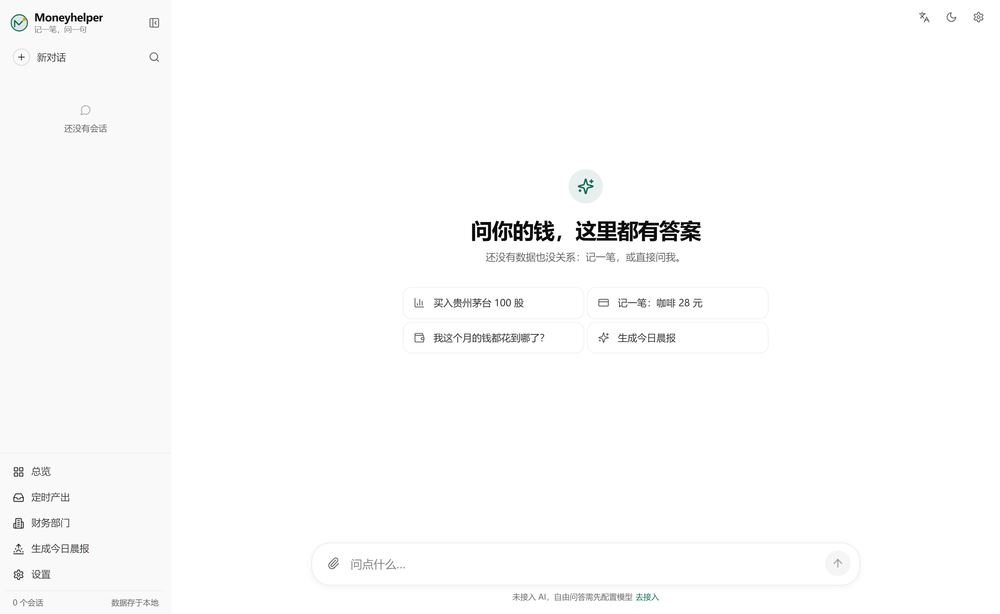 | 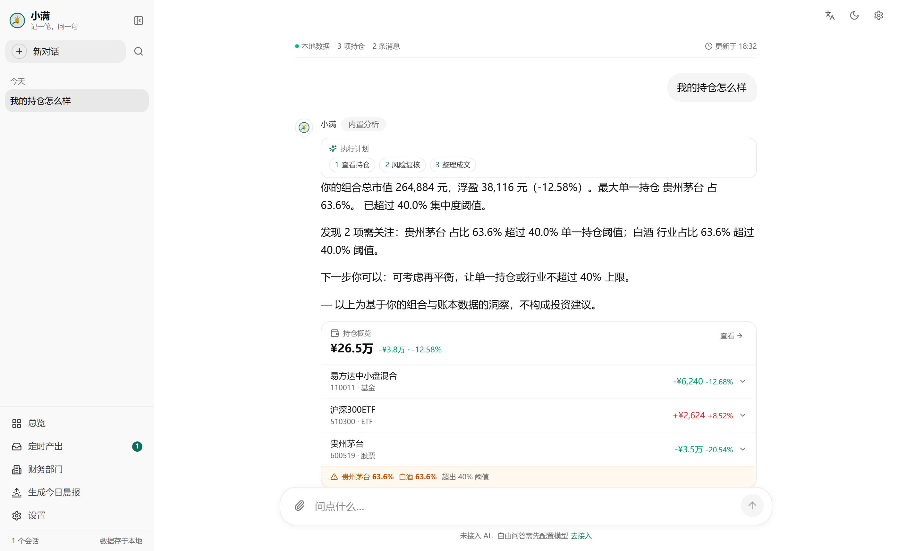 |

| 总览：净资产与收支结构 | 持仓：明细 + 盈亏贡献 |
|---|---|
| 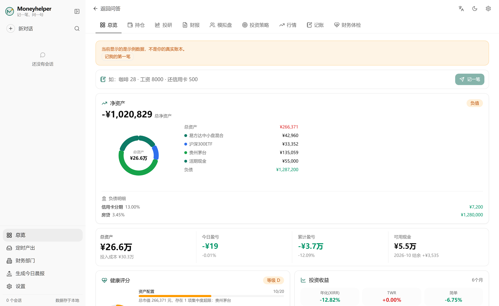 | 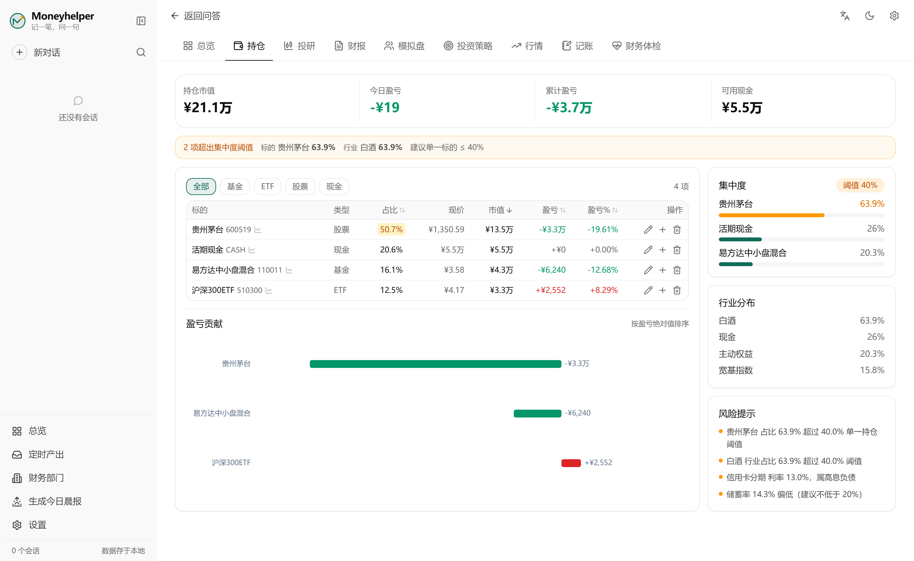 |

| 行情：列表 + 详情 + 迷你走势 | 记账：一句话入账 + 流水表 |
|---|---|
| 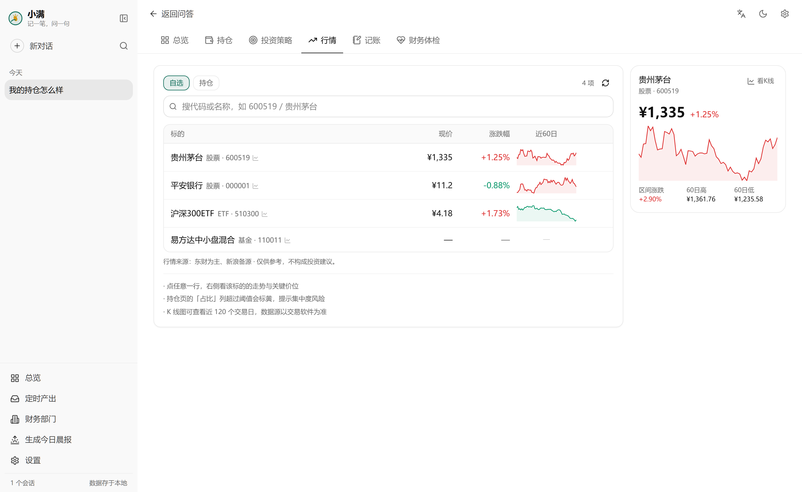 | 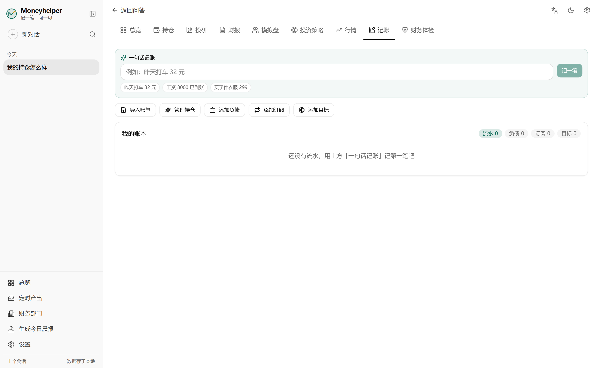 |

| 财务体检：评分 + 优先处理 | 设置：16 个分区 |
|---|---|
| 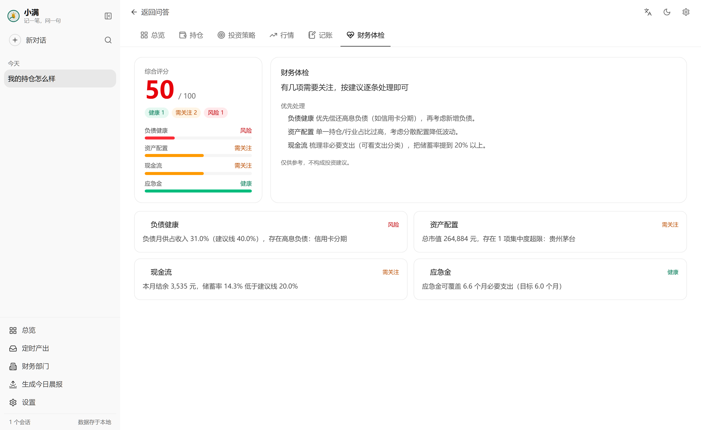 | 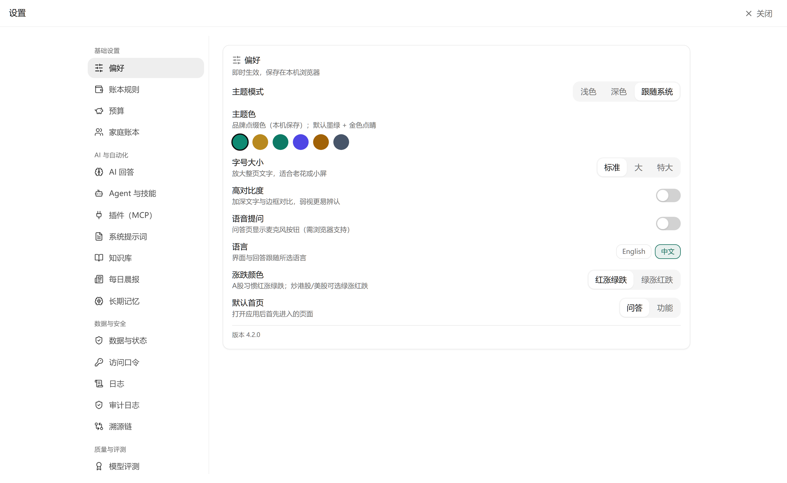 |

| 命令面板（Ctrl+K） | 暗色模式 |
|---|---|
| 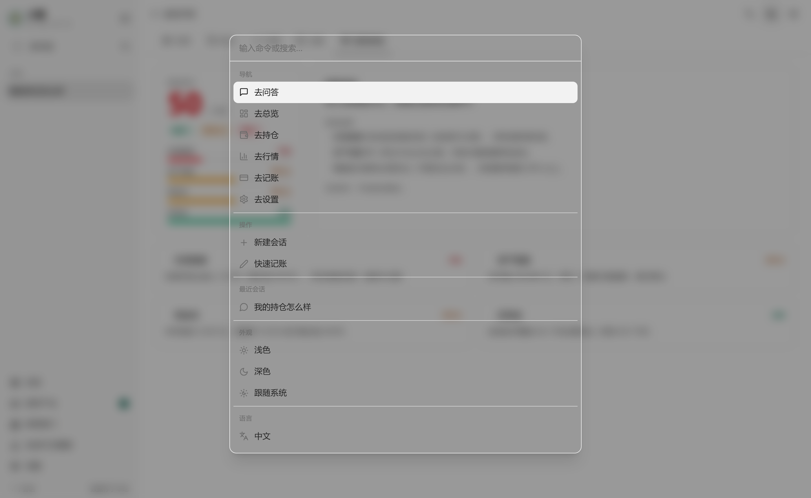 | 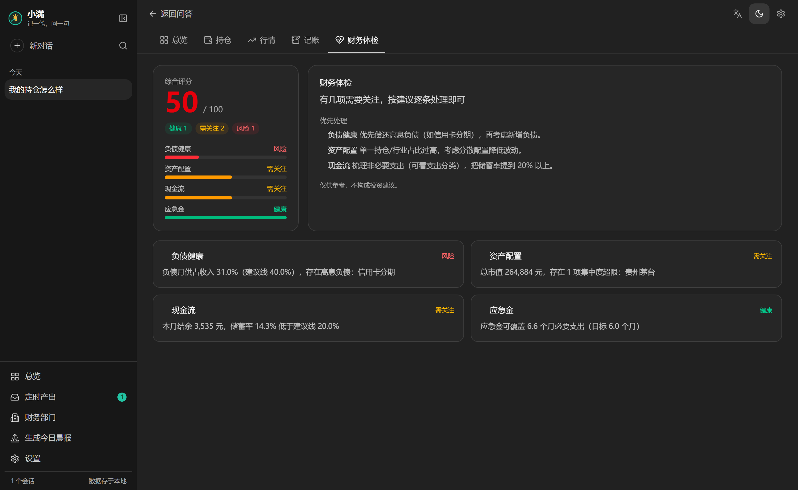 |

| 手机：对话 | 手机：财务 |
|---|---|
| 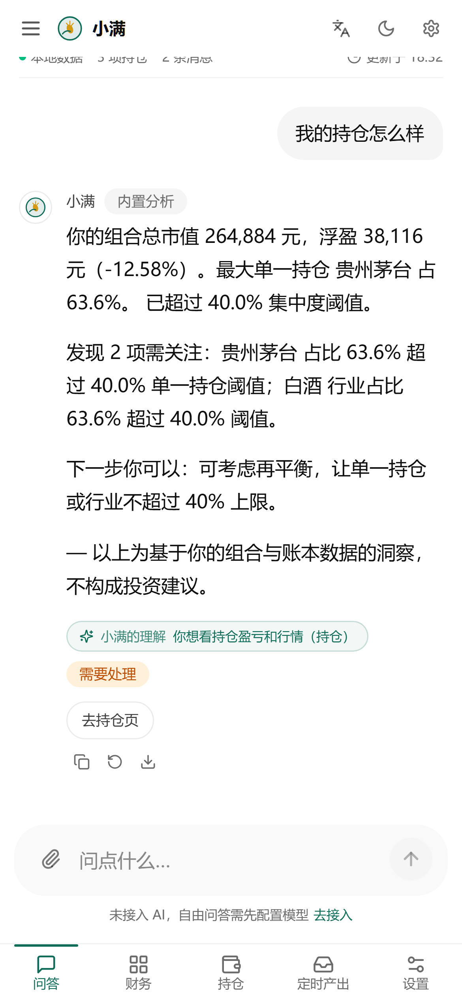 | 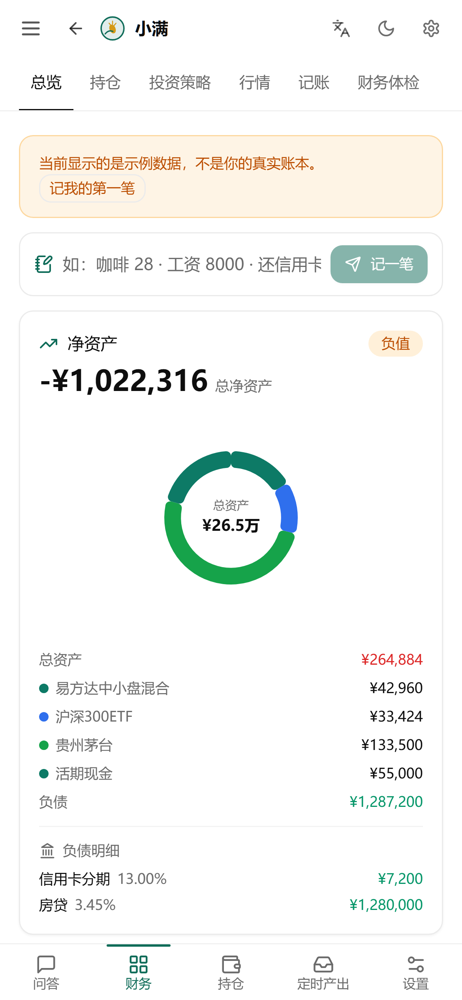 |

| 投资策略：风险 / 再平衡 / 估值 / 定投 / FIRE |
|---|
| 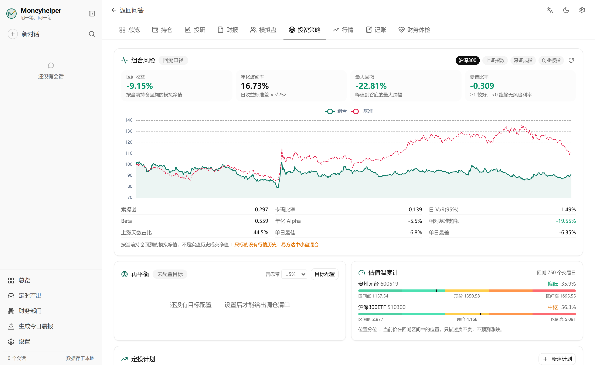 |

更多截图见 [docs/screenshots/](docs/screenshots/)。

## 快速开始

要求：Python 3.10+，Node.js 20.19+。

**最快路径（Docker）**

```bash
# 对外提供服务时务必设置 API_TOKEN，否则只允许本机/内网来源
API_TOKEN=your-token docker compose up -d --build   # 单容器，端口 8787，数据卷 moneyhelper-data
```

**一键启动（开发推荐，Windows / macOS / Linux 通用）**

```bash
scripts/dev.sh          # 开发模式：后端 8788 + 前端 5198（Git Bash / WSL / macOS / Linux）
scripts/dev.sh --prod   # 生产模式：构建前端后单端口 8788 伺服
start.bat               # Windows 双击（自动建 venv、装依赖、开两个窗口）
start.bat --prod        # Windows 生产模式：单窗口、单端口
```

脚本会自动创建虚拟环境、安装依赖、检查端口占用；Windows 的 venv 在 `Scripts/`、Unix 在 `bin/`，脚本会自行判断。

**手动启动**

```bash
# 后端（必须进 backend/ 目录执行）
cd backend
python -m venv .venv
# Windows: .venv\Scripts\python -m pip install -r requirements.txt
.venv/bin/python -m pip install -r requirements.txt
cp .env.example .env   # 可选：填 LLM_* 启用模型，注释里有国产端点示例
# Windows: .venv\Scripts\python -m uvicorn app.main:app --host 127.0.0.1 --port 8788
.venv/bin/python -m uvicorn app.main:app --host 127.0.0.1 --port 8788

# 前端开发模式（/api 代理到 8788）
cd frontend
npm install && npm run dev    # http://127.0.0.1:5198

# 或生产模式：构建一次，后端单端口伺服
cd frontend && npm run build  # 然后打开 http://127.0.0.1:8788
```

数据库默认落在 `backend/data/wealth.db`（`MONEYHELPER_DATA_DIR` / `MONEYHELPER_DB_PATH` 可覆盖，空值会被忽略并回落到默认路径）。

首次启动为空库，各页有对话式引导；AI 不配置也能完整使用。

## 技术栈

| 层 | 技术 |
|---|---|
| 前端 | React 19 + Vite + Tailwind 4 · ECharts · TanStack Table · PWA |
| 后端 | FastAPI + LangGraph 多 Agent 编排 + 确定性分析内核 |
| 数据 | SQLite（aiosqlite + WAL）· 加密备份（PBKDF2 + Fernet） |
| AI | LiteLLM 统一接入（OpenAI 兼容端点）· 本地 BM25 长记忆 · fastmcp |
| 行情 | 东方财富 → 新浪 → 本地快照，三级降级 |

## 架构

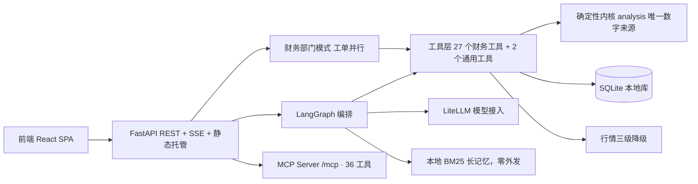

原则：**框架编排，内核算数**。模型只出现在分类与成文环节；模型不可用时自动降级到确定性路径，服务不中断、数字不出错。

关键不变量：
- 写工具对模型不可见（schema 与实现双层剔除），模型无法直接改账本
- 金额、盈亏、风控指标只由 `analysis` / `calculations` 计算
- 长记忆完全本地（BM25），记忆内容不出本机
- 待确认写操作用原子抢占（`claim_pending_action`）保证同一 token 只执行一次

完整架构说明见 [docs/architecture.md](docs/architecture.md)。

## 仓库结构

```
backend/app/
  main.py            FastAPI 入口：REST + SSE + 鉴权 + 静态托管
  db/                数据层（域模块包）：ledger / portfolio / budgets / debts /
                     goals / memory / history / audit / backup / users / family …
  routes/            路由层：budgets / settings / goals / market / import …
  agents/            多 Agent 配置：supervisor / bookkeeping / portfolio
  agent_graph.py     LangGraph 图：supervisor + 专项节点 + 条件路由
  department.py      财务部门模式：工单分解 → 并行取数 → 秘书汇总
  analysis.py        确定性内核：持仓 / 现金流 / 负债 / 集中度 / 风控
  calculations/      组合风险 / 再平衡 / 估值分位 / 定投 / FIRE 模型
  tools.py           Agent 工具层：27 个财务工具 + 2 个通用工具
  quotes.py          行情：东财→新浪→快照 三级降级 + 统一缓存
  nlparse.py         一句话记账：规则引擎 + AI 兜底
  llm.py             LiteLLM 统一模型接入
  mem.py             长记忆封装（本地 BM25 检索，零网络外发）
  mcp_server.py      MCP Server：财务工具标准化暴露
  backup.py          本地加密备份：口令不落盘
  vault.py / auth.py / scheduler.py / observability.py …
frontend/src/
  App.tsx            自适应布局：桌面可拖拽侧栏 / 手机底部导航
  components/        ChatView / Dashboard / HoldingsView / StrategyPage /
                     MarketView / EntryView / SettingsView …
  lib/               api / store / i18n（中英）/ charts / format
docs/                部署 / 配置 / 工作流 / 架构 / 规划文档（见下）
```

## 文档

| 文档 | 内容 |
|---|---|
| [快速上手](docs/quickstart.md) | 5 分钟跑起来 |
| [部署指南](docs/DEPLOY.md) | 本地 / Docker / 外网访问 / 备份迁移（[英](docs/DEPLOY.en.md)） |
| [配置参考](docs/CONFIG.md) | 环境变量 + 设置项 + AI 端点速查（[英](docs/CONFIG.en.md)） |
| [对话工作流](docs/WORKFLOW.md) | 全部一句话玩法（[英](docs/WORKFLOW.en.md)） |
| [架构说明](docs/architecture.md) | 系统架构 Mermaid 图 + 部门模式 + 数据可靠性 |
| [命令行](docs/cli.md) | `moneyhelper add / ls / report / balance / ask`，离线优先，本地与远程同一套命令 |
| [模块清单](docs/module-map.md) | 每个后端模块的体量、结构与职责 |
| [开发指南](docs/DEVELOPMENT.md) | 代码地图 + 加工具/加设置教程 + 发布流程（[英](docs/DEVELOPMENT.en.md)） |
| [实施进度](docs/PROGRESS.md) | 已完成/剩余一页看清 |
| [路线图](docs/ROADMAP-v3.md) | v3 方向 → [详细计划](docs/PLAN-DETAILED.md) |
| [规划归档](docs/planning/) | 审查报告 / 差异化分析 / 调研等十份文档 |
| [变更日志](CHANGELOG.md) | 完整版本历史 |

## 测试

```bash
# 后端：906 个测试（内核 / 策略 / 行情降级 / Agent 循环 / LangGraph / API / 备份往返 / MCP …）
cd backend && .venv/bin/python -m pytest tests -q
cd backend && .venv/bin/python -m ruff check app tests

# 前端：tsc + 构建 + 111 个单测 + 21 个 Playwright e2e
cd frontend && npm run build
cd frontend && npm run test:e2e
```

CI 覆盖后端 ruff（app + moneyhelper 包）+ pytest、前端 tsc + vitest + build，
另有一个仓库卫生 job：禁止 >1MB 文件、`mkdocs build --strict` 必须通过。

## 数据与隐私

- 个人数据只存本机 SQLite；行情走东财 / 新浪公开接口；模型调用只发往你自己配置的端点。
- 推荐带口令加密备份；明文导出会强提示。无遥测、无埋点、无第三方统计。
- 鉴权：设置 `API_TOKEN` 后所有 `/api/*` 要求 Bearer 或 `?token=`；未设 token 时仅允许本机与 `ALLOWED_HOSTS` 白名单访问。

## 免责声明

本软件输出的全部内容（财务体检、晨报、AI 回答、目标与预算建议）仅供参考，不构成投资建议。市场有风险，投资需谨慎。

## 参与贡献

- 协议：[MIT](LICENSE) · 贡献指引：[CONTRIBUTING.md](CONTRIBUTING.md) · 行为准则：[CODE_OF_CONDUCT.md](CODE_OF_CONDUCT.md) · 安全说明：[SECURITY.md](SECURITY.md)
- 欢迎 Issue 与 PR；新功能请配套测试，提交前过一遍上面的测试命令。

**Topics**：`personal-finance` `finance-assistant` `ai-agent` `langgraph` `fastapi` `react` `sqlite` `local-first` `mcp` `pwa` `记账` `开源理财`
