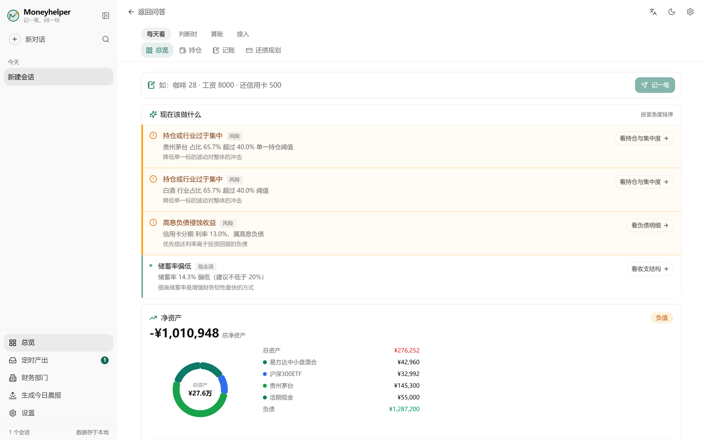
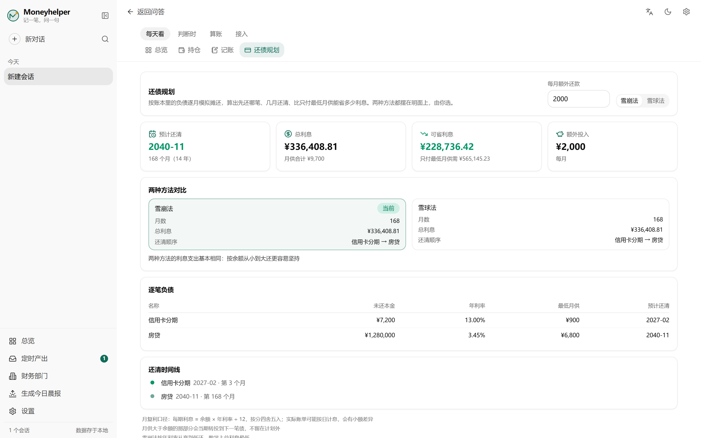
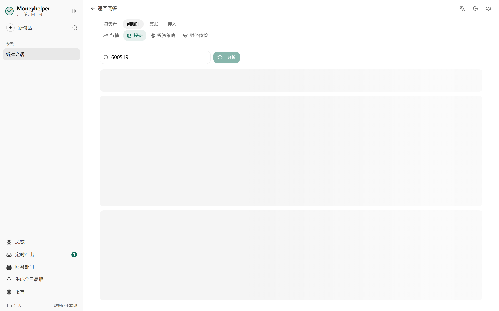
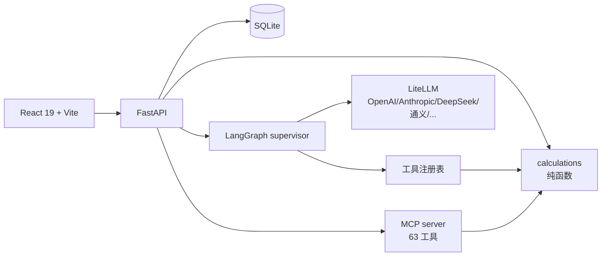

# Moneyhelper

**一个能审计的 AI 财务部门。** 记账、持仓风控、投研、财报、税负、资金调度——每一个数字都由确定性代码算出，模型不碰数字。

[English](README.md) · 简体中文 · [文档](docs/index.md) · [CLI](docs/cli.md) · [部署](docs/DEPLOY.md)

[](https://github.com/badhope/moneyhelper/actions/workflows/ci.yml)
[](https://github.com/badhope/moneyhelper/releases)
[](#验证)
[](LICENSE)
[](pyproject.toml)
[](docs/mcp-guide.md)

<p align="center">
  
</p>

---

## 安装

```bash
# 1) 桌面版 —— 下载即用，无需 Python
#    release 资产：moneyhelper-windows-x64.exe / moneyhelper-macos-arm64 / moneyhelper-linux-x64

# 2) Docker
docker compose up -d                 # → http://localhost:8787

# 3) 源码
scripts/dev.sh --prod                # venv + pip + 前端构建 + 8788 端口起服务
pip install -e . && moneyhelper add "午餐 45 打车 28"
```

源码安装需要 Python 3.10+ 与 Node 20.19+。数据存在本地 SQLite 文件里——不需要账号、不上报埋点、不绕云端。

---

## 能做什么

| | |
|---|---|
| **账本** | 一句话记多笔：`午餐 45 打车 28` 变成两条流水。微信支付、支付宝、银行 CSV、PDF 对账单、发票二维码与 OCR 都能原生导入。 |
| **持仓** | 持仓明细、集中度与行业分布、盈亏归因、按整手取整的调仓清单。 |
| **还债规划** | 雪崩法 vs 雪球法、逐月摊还模拟、还清日期，以及「多还这些钱到底省多少利息」。 |
| **投研** | 技术指标、5 个回测策略、统计情景推演（趋势回归 / 波动率区间 / 固定种子的蒙特卡洛）。 |
| **财报** | 三表分析：20+ 指标、杜邦分解、同比变动、异常预警。 |
| **税负（中国）** | 增值税及附加、企业所得税、个税累计预扣、含五险一金的工资核算。 |
| **现金流** | 三档预测、订阅识别、中位数 + MAD 的异常扣款检测。 |
| **报告** | 单文件可交互 HTML，离线可看，可打印成 PDF。 |
| **MCP** | 63 个工具走 Model Context Protocol——任何 MCP 客户端都能驱动账本。 |

<p align="center">
  
  
</p>

---

## 数字为什么站得住

计算层是纯函数：没有网络、没有数据库、没有随机（蒙特卡洛固定种子）。

```
提问 → 意图路由 → 工具调用 → calculations/*.py（纯函数）
                                    ↓
                            数字回填 → 模型只负责组织语言
```

**模型没有编造数字的通道。** 它拿到的是算好的结果，只能措辞。每个数字都带溯源记录，每个指标都在 docstring 里写清公式与失效场景——样本不足时返回 `null` 加原因，而不是一个看起来合理的数字。

两条都是被真正执行过、而不是嘴上说说的纪律：

- 回测曾经在净值下跌 62% 时报「年化 +44887%」——曲线漏了现金、用首尾之比当收益率。已改为曲线含现金、年化走 XIRR、回撤与夏普基于 TWR 序列。
- 同一份数据，健康分走 MCP 是 54/D、走 REST 是 83/B。现在两侧调用同一个函数。

---

## 设计原则

**默认本地，随处可部署。** 数据在你机器的 SQLite 里；同一套核心跑成桌面单文件、自托管服务或容器。发给模型服务商的只有脱敏后的结构化上下文——账本本身不出门。

**中国账单是一等公民。** 微信、支付宝导出走结构化解析，不是「通用 CSV 猜列名」的兜底。发票二维码解码与 OCR 是真解码器；可选依赖缺失时明确提示装什么，而不是静默失败。

**交易永不盲目自动化。** 预交易检查（涨跌停、整手、T+1、集中度、日限额、重复单）产出确认令牌；实盘只生成交接单。默认券商适配器是 `NullBroker` + dry-run。

**失败要降级，不能 500。** 行情拉不到时，受影响的卡片返回 `available: false` 并说明原因，页面其余部分照常工作。回测是纯计算，行情不可用时依然可用——而那正是你想离线复盘的时候。

---

## 架构



```
backend/app/
  calculations/    确定性引擎 —— 无 I/O，可独立单测
  routes/          HTTP 层：只做参数清洗与组装
  db/              按域拆分的 SQLite 访问、迁移、撤销快照
  import_parsers/  微信 / 支付宝 / 通用 CSV / PDF / 发票解析
  agents/          supervisor + 记账 + 持仓 + 投研
moneyhelper/       稳定门面包（core / server / cli / mcp）
frontend/src/      React 界面，按区块懒加载
```

细节见 [architecture.md](docs/architecture.md) · [module-map.md](docs/module-map.md)

---

## 验证

```bash
cd backend  && pytest -q                              # 1500+ passed
cd frontend && npx vitest run && npx tsc --noEmit     # 180+ passed，零类型错误
node frontend/e2e/shots-full.mjs http://127.0.0.1:8788  # 22 张截图，零溢出
python backend/scripts/seed_hostile.py .tmp/h.db      # 敌意数据渲染检查
```

CI 门禁：ruff、pytest、`tsc --noEmit`、vitest、生产构建、mkdocs `--strict`、1MB 大文件检查。

三条用户链路各有自动化门禁——因为单测全绿只能证明函数对，证明不了用户够得着：

| 门禁 | 证明什么 |
|---|---|
| HTTP | 逐个探测 OpenAPI 端点无 5xx；4xx 必须带可读文案，不是堆栈 |
| MCP | 工具表面与注册表一致，并用 SDK 客户端跑真实协议调用 |
| 渲染 | 敌意数据（10.8k 字符名称、±Infinity、纪元日期）零页面报错、零溢出 |

---

## 边界

- 不代客下单；只出交接单并要求确认。
- 不给税务筹划建议；按公开公式计算，结果标注为测算。
- 不预测收益；回测写明假设与失效条件。
- 可选能力（OCR / PDF 解析 / 券商 SDK）缺失时给出安装提示，不静默失败。

MIT License · [安全策略](SECURITY.md) · [贡献指南](CONTRIBUTING.md) · [变更记录](CHANGELOG.md)
