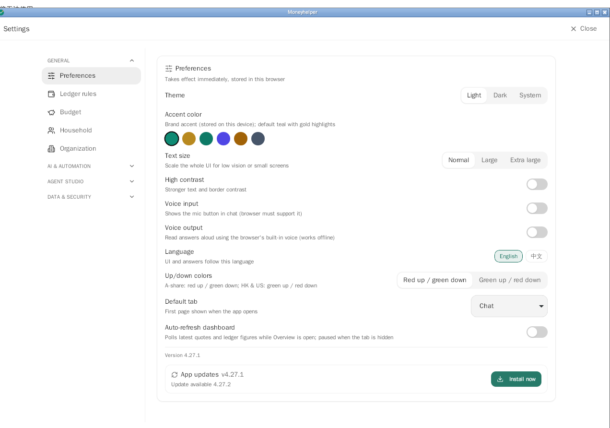
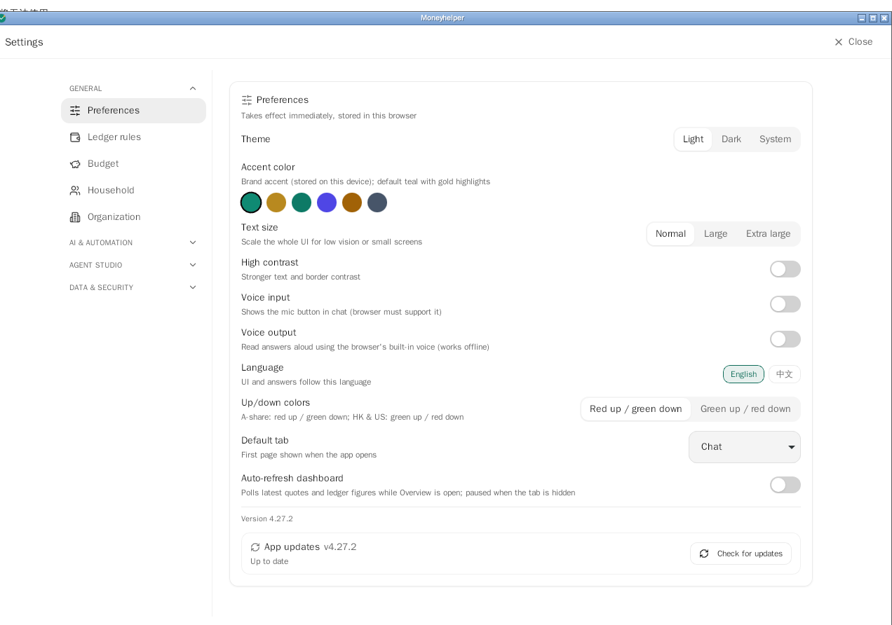
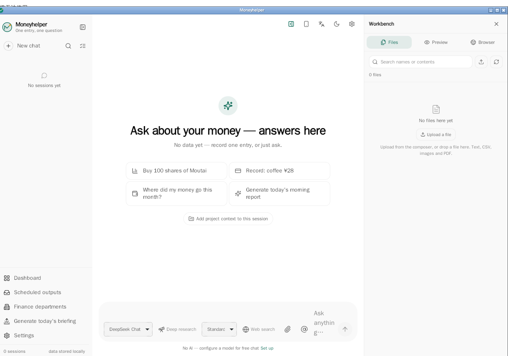

# Moneyhelper 4.27.2 发布与升级验收

## 这版做了什么

- 打开设置页时自动静默检查更新，不再要求用户先手动点一次。
- 修复本地 sidecar 页面的 ACL：`check_update` / `install_update` 在 `build.rs` 显式登记，capability 只放行这两个命令与 `core:default`，remote 仅限 `127.0.0.1`。
- 检查失败后仍保留「检查更新」按钮，网络恢复可直接重试。

## 应用内升级实测

起点是 4.27.1 AppImage：

- 原文件 SHA256：`d642caf6717feb250760a8880403285a26b52725b01118f1c7d224aa06db5e56`
- 设置页检查到 `4.27.2`，点击「Install now」后显示下载安装状态，应用退出并自动重启。
- 升级后原文件 SHA256：`0aa3ad0b87f927282b24485c661cca0e627494bb15be0dd9c3eafbecb951dada`，与 Release 中 `Moneyhelper_4.27.2_amd64.AppImage` 完全一致。
- 重启后设置页显示 `Version 4.27.2`，更新卡片自动变为 `Up to date`，sidecar 正常拉起。

升级前后界面：

## Debian 包验收

- `sudo apt update && sudo apt install ./Moneyhelper_4.27.2_amd64.deb` 安装成功，包版本 `4.27.2`，自动补齐 `libwebkit2gtk-4.1-0 2.50.4`。
- 启动后 `/api/health` 返回 `{"ok":true,...}`；上传含文本 PDF 返回 `text_extracted: true`。
- 关闭窗口后 `moneyhelper-desktop` 与 `moneyhelper-server` 均退出，端口无监听。

## 升级边界

- Linux AppImage 可直接自替换；`.deb` 在普通用户下没有写 `/usr` 权限，应用内更新会提示失败，应改用 `sudo apt install` 覆盖安装。
- Windows NSIS 更新会拉起安装器并退出当前进程；macOS 更新后会重启应用。
- Windows 仍未 Authenticode、macOS 仍未公证，首次安装可能出现系统安全提示。

## 安装包位置

`releases/4.27.2/` 已放好 `.deb`、AppImage、Windows NSIS、macOS 包、`latest.json` 与 `SHA256SUMS.txt`。二进制超过 GitHub 单文件 100MB 限制，未提交 Git，但完整保留在代码目录与 GitHub Release。
