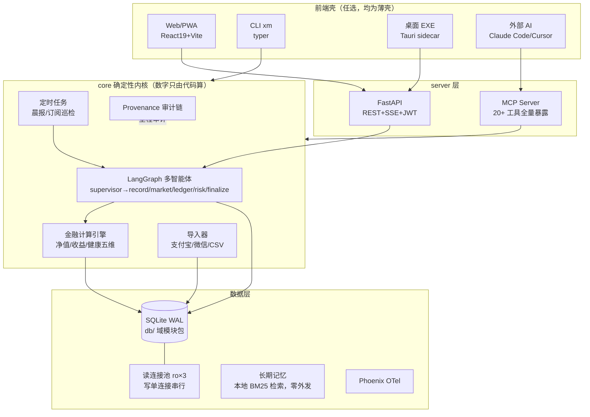
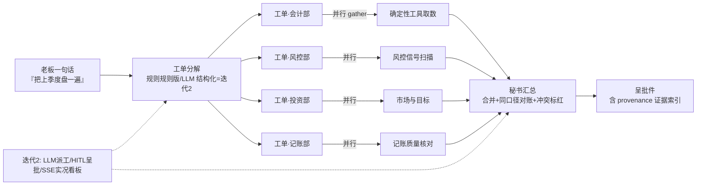
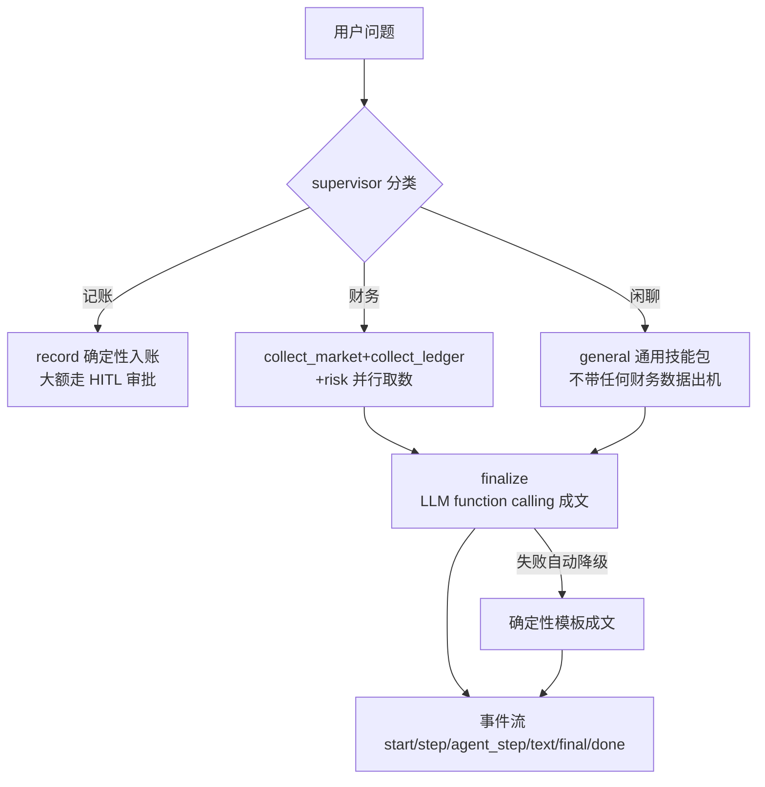
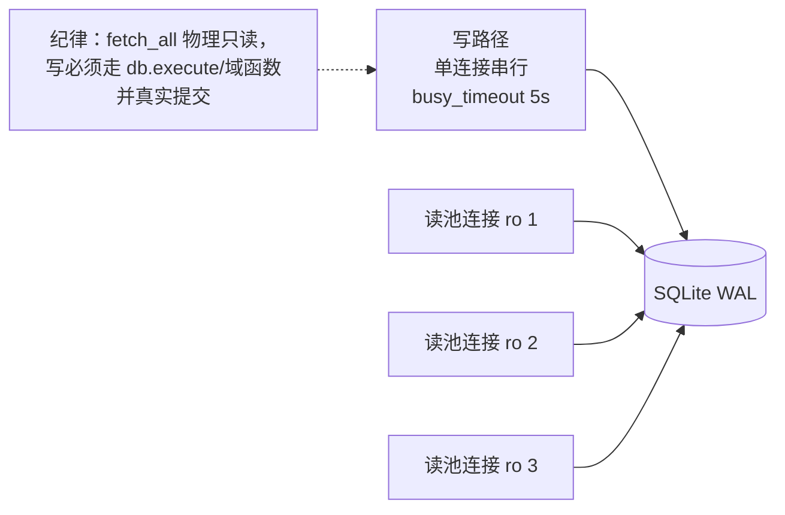

# Moneyhelper 架构图

> 本页用 Mermaid 绘制，GitHub 原生渲染。配套：[ROADMAP-v3](ROADMAP-v3.md) / [详细计划](PLAN-DETAILED.md)

## 1. 系统总架构（部署形态无关：云 API / 自托管 / 桌面单机共用同一 core）

## 2. M3 财务部门模式（已上线骨架 v0）

## 3. 问答执行路径（单轮，agent_graph）

## 4. 数据可靠性（M1.3 之后）

