# Agent Studio（角色 / 技能 / 提示词 / 约束 / Hook / 市场）

设置中心的 Studio 部分把「Agent 能力」从代码里的硬编码变成可编辑的数据。
默认包非空：新装即可用，用户可关闭、删除、替换。

## 组成

| 分区 | 存哪里 | 运行时落点 |
|---|---|---|
| 角色（Agent） | `agent_config` 的 `agents` | 主角色指令进入系统提示；`tools` 白名单约束工具面 |
| 技能（Skill） | `agent_config` 的 `skills` | 内置技能映射到工具开关；自定义技能作为指令注入；`action` 生成定时任务 |
| 提示词（Prompts） | `studio_config.prompts` | 按 `priority` 降序拼接进系统提示 |
| 约束（Rules） | `studio_config.rules` | 按 `scope`（all/finance/research）与 `severity` 拼接进系统提示 |
| Hook | `studio_config.hooks` | `pre_tool` 拦截/告警；`pre_prompt` 注入；`post_answer` 审计 |
| 内置工具 | `studio_config.internal_tools` | 只进内部工具面（不进 MCP 对外清单），逐个可开关 |
| 权限 | `studio_config.permissions` | 控制对话/CLI/URL 安装是否可写；核心项永远锁定 |
| 市场 | `studio_config.marketplace` | 一键安装开源资产；MCP 只写配置，默认停用 |

## 四种添加方式（每个分区都有）

1. **对话添加**：`添加技能 定投提醒：每周日晚8点检查定投计划`。需要「全面放开」权限。
   解析是规则式的：只识别结构清晰的短指令，不做猜测式写入。
2. **拖拽 / 上传导入**：`SKILL.md`（YAML frontmatter）、单文件 Markdown、JSON/YAML
   （单资产或整包）、ZIP（逐文件解析，单个失败逐条报错）。
3. **模板手写**：从后端拉模板字段，填完即校验（id 规则、长度上限、枚举、正则合法性）。
4. **AI 一键生成**：一句话描述 → 模型产出 JSON → 后端二次校验 → 采用后落库。
   未接入模型时明确返回「先配置模型端点」，不伪造结果。

## 权限模型

- `open`（全面放开）：设置页、对话、CLI 都可改；`allow_chat_admin` / `allow_cli_admin`
  可再细分；`allow_remote_install` 控制 URL 安装。
- `standard`：只能设置页手动改，对话与 CLI 的写操作返回 403。
- `strict`：Studio 配置只读。

核心项（任何模式都不可改）：`approval_threshold`（含下限）、`ai_api_key`、`api_token`、
`internal_tools_visibility`、`destructive_confirm`。后端 `POST /api/studio/core-guard`
是唯一判定入口，前端把控件显示为锁定并解释原因。

## 出厂预装

首次启动（`marketplace.seeded` 为空）会把市场里全部非 MCP 资产装好并启用：

- 官方 Agent Skills 精选（PDF / Word / Excel / skill-creator / mcp-builder 等）
- 科研类技能（论文写作、审稿、文献综述、引用管理、EDA、科研绘图、学术 Office）
- 科研/财务/工程角色，科研规则与提示词，科研 Hook
- MCP 预设（fetch / filesystem / memory / sequentialthinking / time / git / deepwiki / gitmcp / arxiv / zotero / paper-search）
  只写配置、默认停用（stdio 依赖 npx/uvx，离线启用会拖慢问答）

`seeded=true` 之后不再执行，所以用户删掉的条目重启不会复活。

远程 HTTP MCP（deepwiki / gitmcp）默认启用；stdio MCP（fetch / filesystem / memory /
sequentialthinking / time / git / arxiv / zotero / paper-search）默认停用——它们依赖
`npx`/`uvx`，缺失时每轮问答都要等一次启动失败。设置页提供「全部启用 / 全部停用」，
并会把发现失败的服务器标红（失败后 30 分钟内不重试，避免拖慢首 token）。

## 内置优势工具（自研，不对外）

8 个确定性工具：`research_outline`、`citation_format`、`literature_search_plan`、
`dataset_profile`、`stats_summary`、`sensitivity_analysis`、`experiment_design_check`、
`source_quality_score`。

它们只在内部 Agent 工具面暴露，**不会出现在 MCP Server 的对外工具清单**；设置页默认只显示
「已启用 N 个」，清单需要显式展开。全部纯标准库、不联网、可单测。

## API

| 方法 | 路径 | 说明 |
|---|---|---|
| GET | `/api/studio/overview` | 计数 / 权限 / 主角色 / 看门狗状态 |
| GET | `/api/studio/{kind}` | 列出资产（kind = prompts/rules/hooks/roles/skills） |
| POST | `/api/studio/{kind}` | 新建（服务端生成 id） |
| PATCH | `/api/studio/{kind}/{id}` | 局部更新 |
| DELETE | `/api/studio/{kind}/{id}?force=` | 删除（内置需 force） |
| POST | `/api/studio/{kind}/{id}/toggle` | 启停 |
| POST | `/api/studio/import` | multipart 上传（md/json/yaml/zip） |
| POST | `/api/studio/import/url` | 从 URL 安装（GitHub blob 走 contents API） |
| POST | `/api/studio/generate` | AI 生成建议（不落库） |
| POST | `/api/studio/generate/apply` | 采用建议并落库 |
| GET | `/api/studio/market/list` | 市场清单 + 已安装状态 |
| POST | `/api/studio/market/install` | 安装单个条目 |
| POST | `/api/studio/market/install-recommended` | 安装推荐组合 |
| GET/PUT | `/api/studio/permissions` | 权限读写 |
| POST | `/api/studio/core-guard` | 核心项判定（一律拒绝并说明） |
| GET/POST | `/api/studio/watchdog` | 看门狗状态 / 配置 |
| POST | `/api/studio/watchdog/run` | 立即检查 |
| GET | `/api/studio/internal-tools` | 内置工具清单 |
| POST | `/api/studio/internal-tools/toggle` | 单个/总开关 |
| GET | `/api/studio/diagnostics` | 一键自检（真实检查，不是静态文案） |
| POST | `/api/studio/chat-command` | 对话式配置（与聊天内解析同一实现） |

## CLI

```bash
moneyhelper studio list                       # 全部资产概览
moneyhelper studio list --kind skills         # 只看技能
moneyhelper studio add --kind rules --name "不推荐个股" --content "只描述风险" --severity must
moneyhelper studio toggle --kind skills --id dca_reminder --off
moneyhelper studio remove --kind rules --id cli_rule
moneyhelper studio import --file ./my-skill/SKILL.md --kind skills
moneyhelper studio market                     # 市场清单
moneyhelper studio market --install skill-pdf
moneyhelper studio ai --kind skills --prompt "每周日检查定投"
```

远程模式（`--url/--token`）支持 `list / add / remove`；其余动作在本地或设置页执行。

## 故障排查

- 对话里说「添加技能 …」没反应：检查「设置 → 权限」是否为「全面放开」且允许对话管理。
- 导入报错：错误会指到 `文件 + 字段 + 原因`；`SKILL.md` 必须有 `name`（frontmatter 或一级标题）。
- MCP 工具列表为空：服务器默认停用或离线；先「测试连接」，再切换启用。
- 一键生成失败：未接入模型时直接提示；接入后模型返回非 JSON 会给出「换个描述重试」。

## 截图

| 对话内创建 | 角色 | 技能 |
|---|---|---|
| 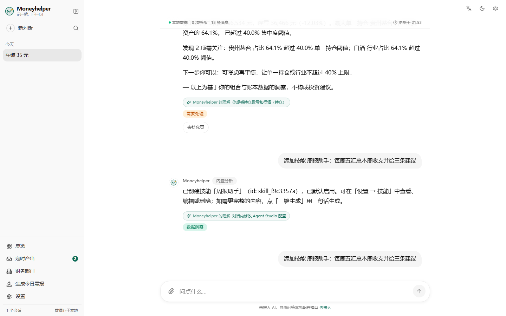 | 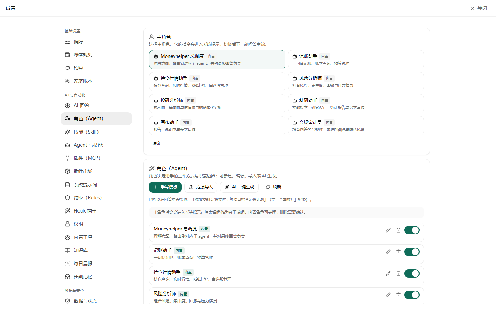 | 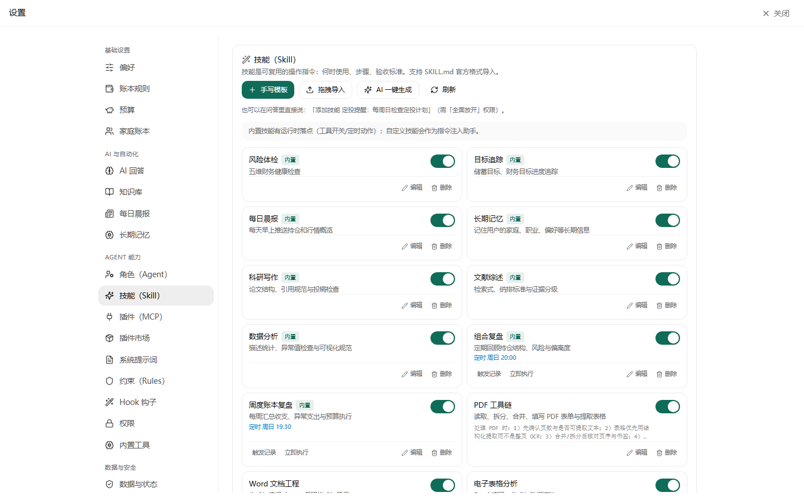 |

| 权限 | 插件市场 | 内置工具 |
|---|---|---|
| 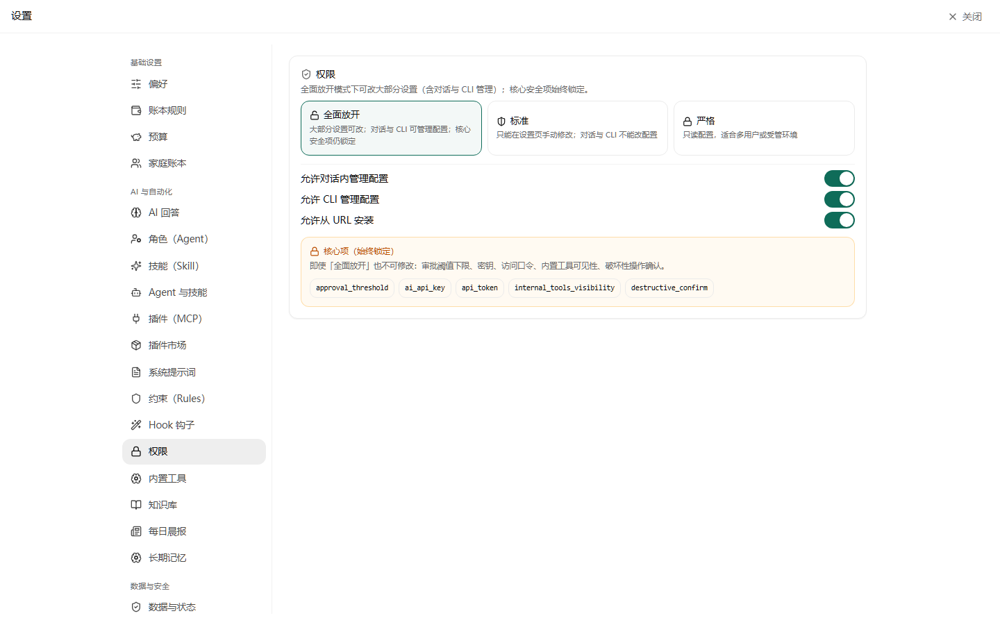 | 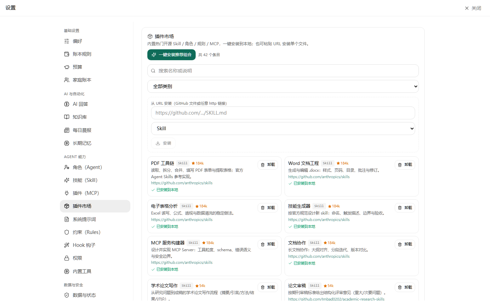 | 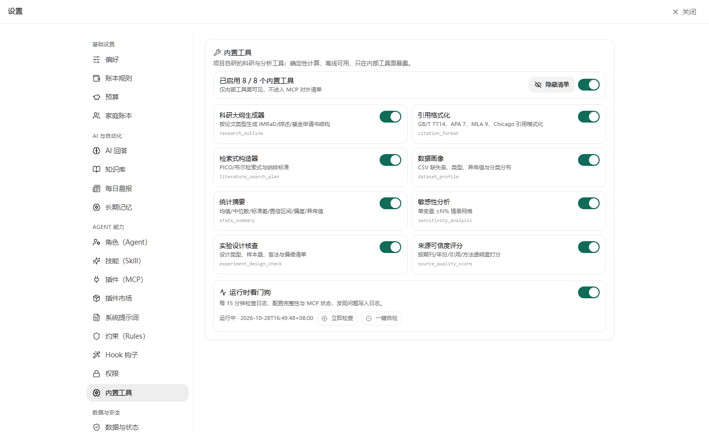 |

| 技能表单（含定时动作） | 角色表单（工具白名单/温度） | 市场筛选科研 MCP | 深色模式 |
|---|---|---|---|
| 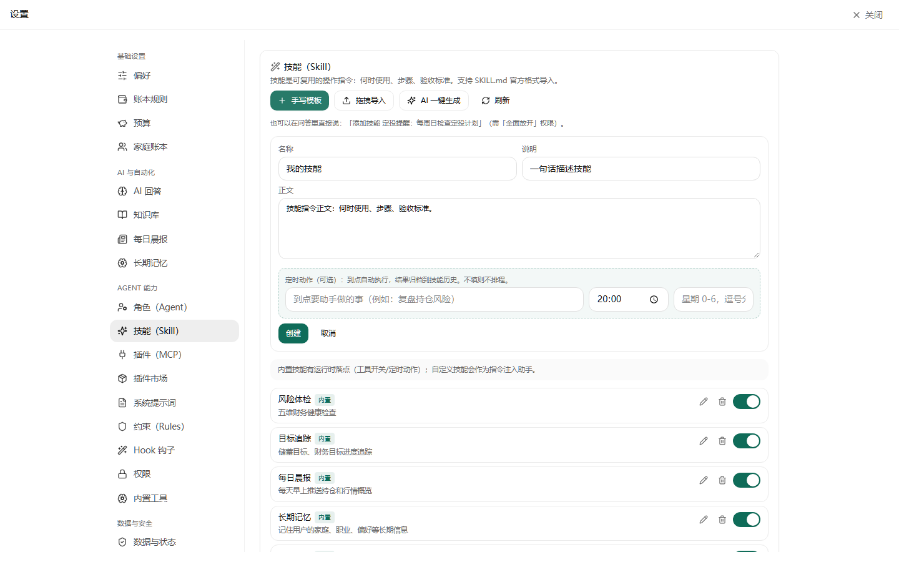 | 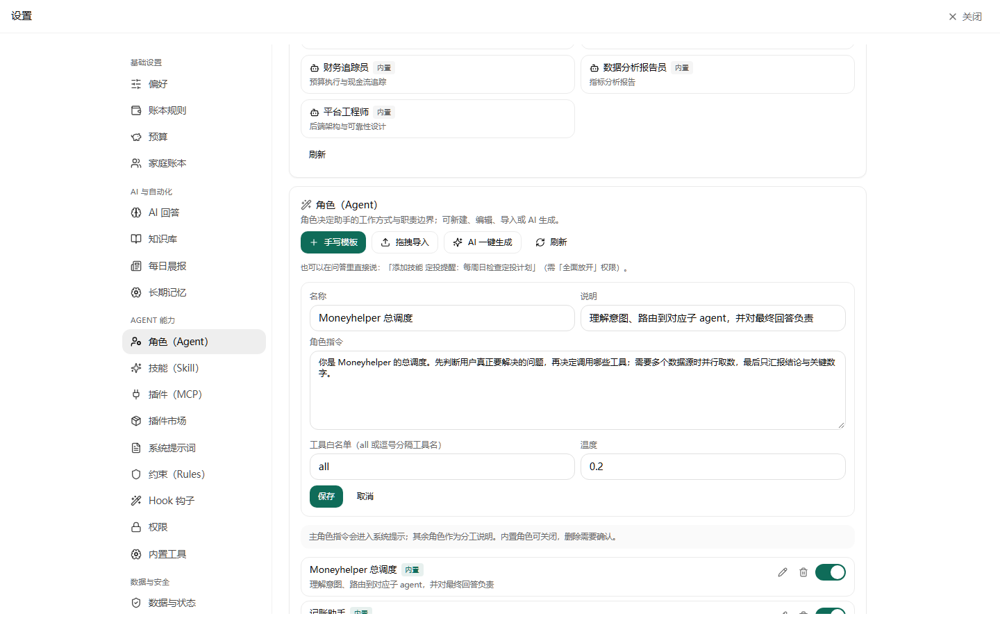 | 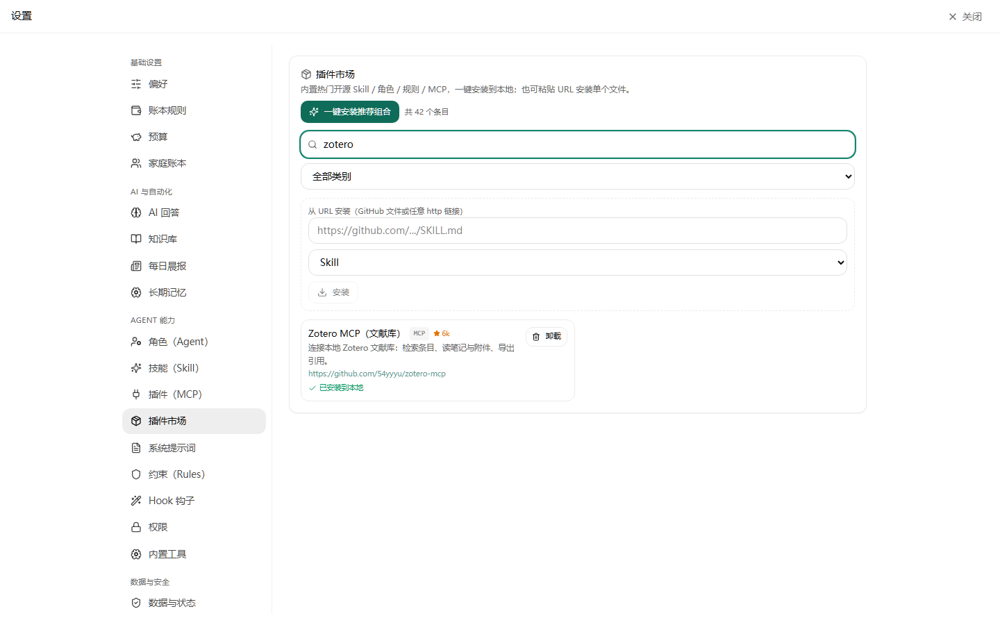 | 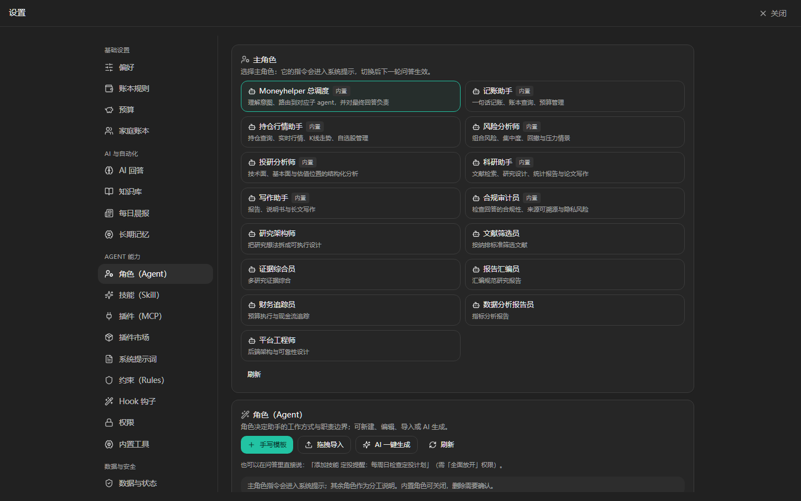 |

| 约束（卡片网格） | Hook | 导入格式示例 | 移动端 |
|---|---|---|---|
| 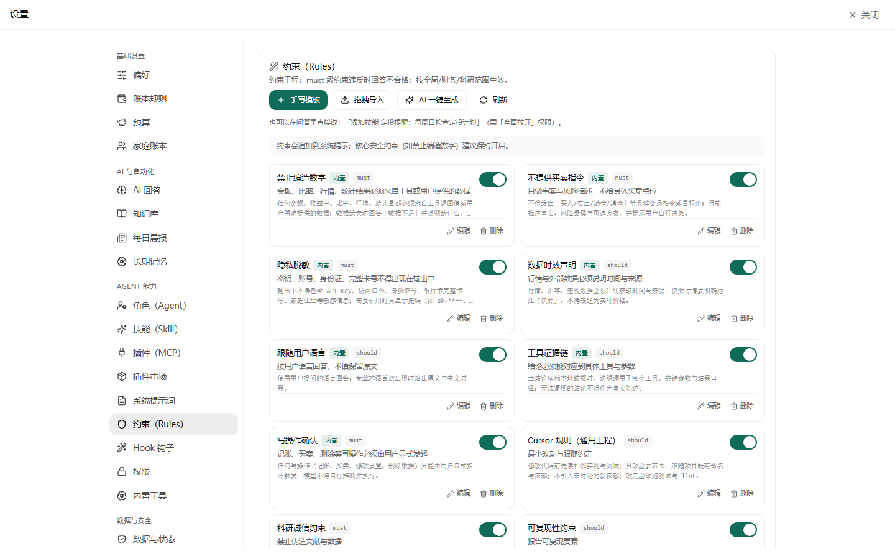 | 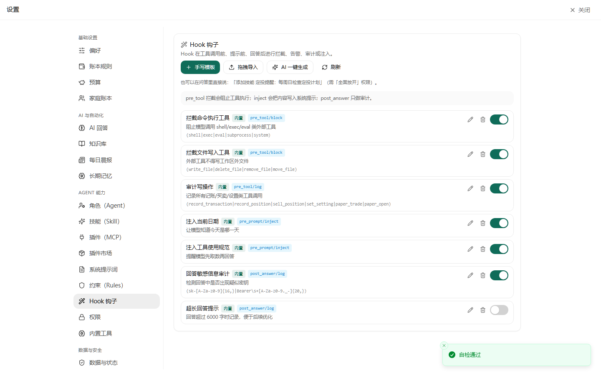 | 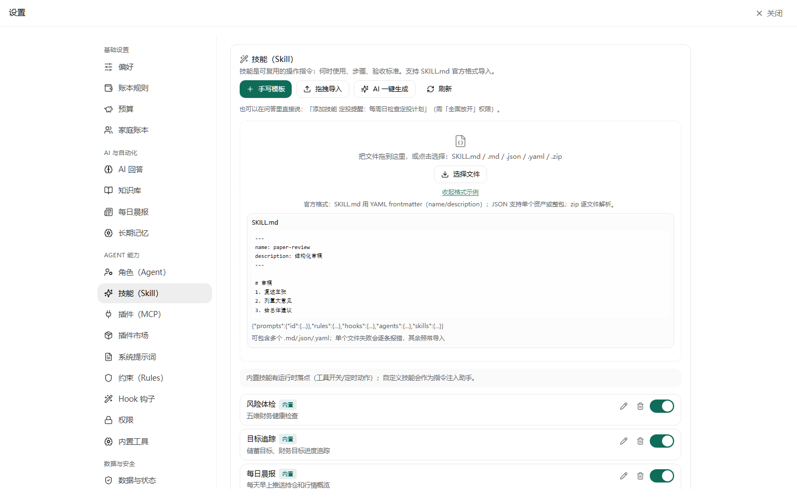 | 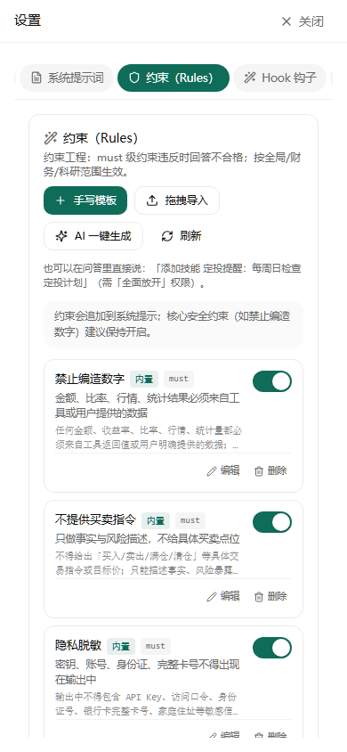 |

| MCP 卡片 | 移动端 MCP |
|---|---|
| 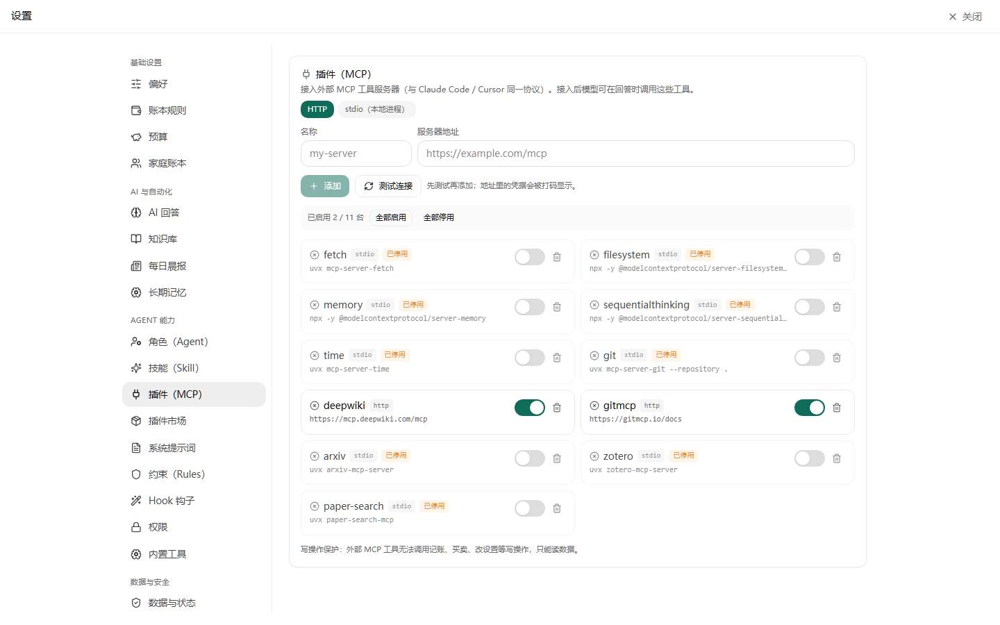 | 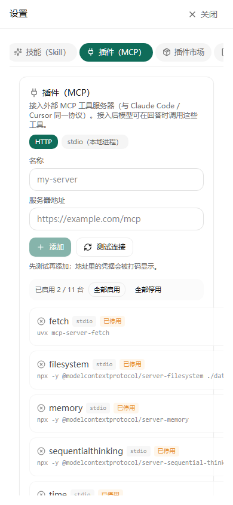 |
